# pi-openui

Interactive dashboards, charts, diagrams and maps in the terminal, for the [pi](https://github.com/earendil-works/pi)
coding agent. The agent writes a few lines of OpenUI Lang. pi draws a widget you can click or drive with the keyboard.

It uses unicode characters, and real pictures where the terminal can show them. There is no browser, no HTML, no runtime
dependency and no network access.

<table>
<tr>
<td valign="top">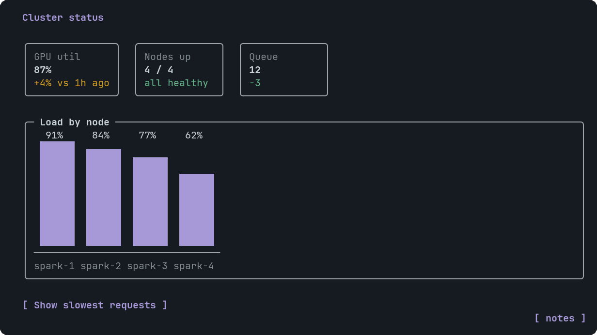</td>
<td valign="top">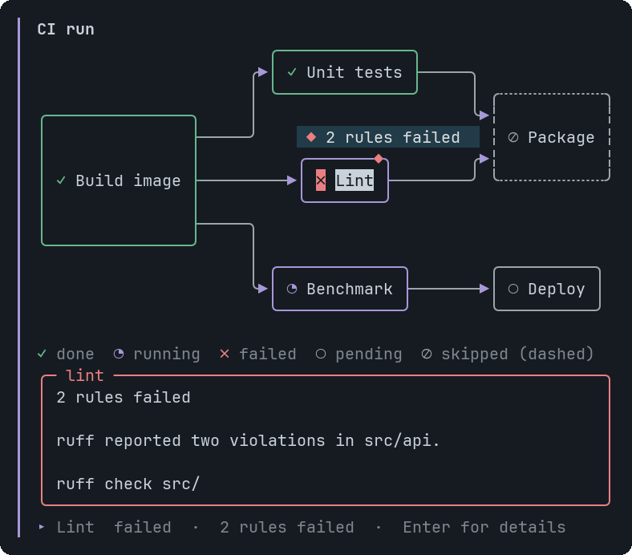</td>
</tr>
<tr>
<td valign="top">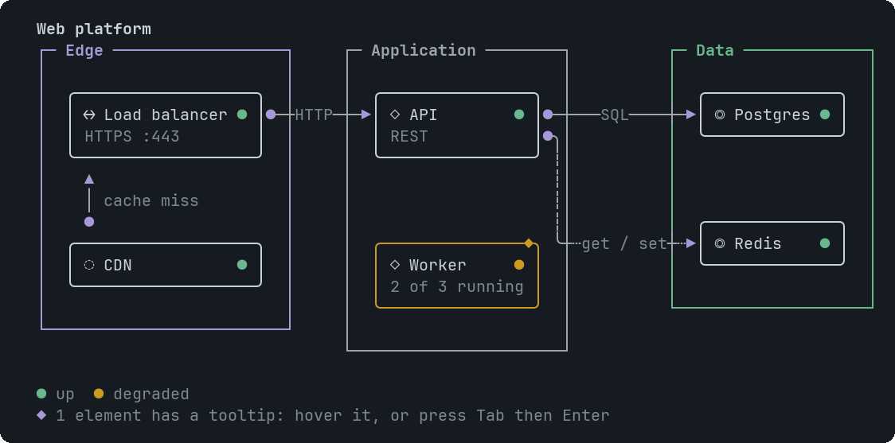</td>
<td valign="top">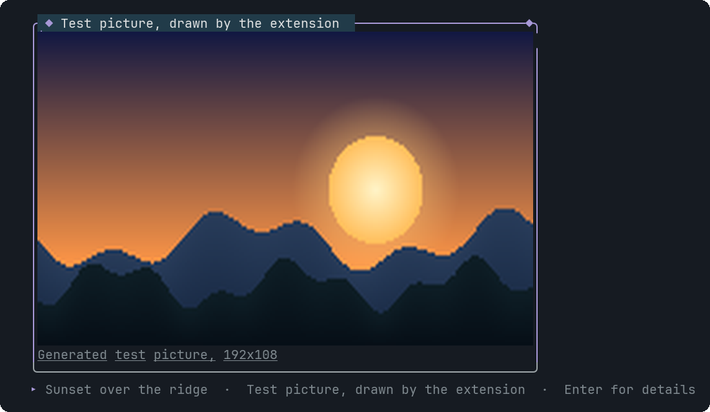</td>
</tr>
<tr>
<td valign="top">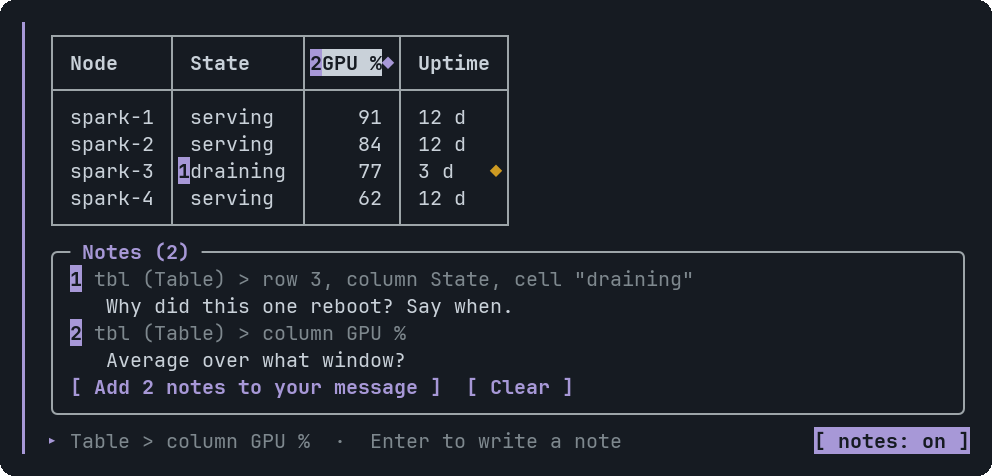</td>
<td valign="top">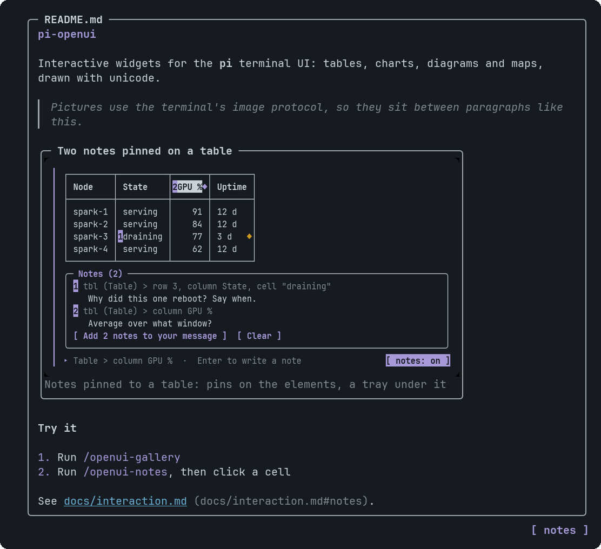</td>
</tr>
</table>

<sub>Screenshots are drawn by `npm run screenshots` from the widget's real output, with pi's dark theme and JetBrains Mono.</sub>

## What you get

- **One tool, `render_widget`.** The agent calls it with OpenUI Lang. Mistakes come back as a list of errors with line
  numbers, so it fixes them and tries again. After a successful draw it says one short sentence.
- **23 components.** Layout and text, metric tiles, tables, tabs, buttons and choices, FAQ, markdown, code with
  highlighting and a copy button, images, bar, line, area, pie and radar charts, a world map, and four diagram types
  (DAG, ER, infrastructure map, sequence). See the [component gallery](docs/components/README.md).
- **Interaction.** Click, or use Tab, the arrow keys, Enter and Esc. A button or a choice sends text to the agent as your next
  message. See [docs/interaction.md](docs/interaction.md).
- **Notes.** Pin a comment to a table cell, a graph node or a pie slice, then send all of them to the agent as one numbered
  message. You read and edit the message before it goes. See [Notes](#notes).
- **Tooltips.** An element with a tooltip shows a small `◆`. Hover for a hint bubble, click or press Enter for a panel with
  detail, code and a link. See [Tooltip](docs/components/Tooltip.md).
- **Pictures.** An `Image` draws the real picture in terminals that speak the Kitty graphics protocol, inside a frame that
  can carry a tooltip. A line of Markdown that is only a picture, ``, is drawn the same way, so a
  README-style view is one `Markdown`. See [Image](docs/components/Image.md) and [Markdown](docs/components/Markdown.md).
- **Robust diagrams.** Every graph, schema and map is routed on a character grid with one wire per edge. The tests decode
  the finished picture back into its edges and compare them with the input. See [docs/diagrams.md](docs/diagrams.md).

## Install

pi installs packages straight from git, so a GitHub repository is enough. There is nothing to build or `npm install`.

```sh
pi install git:github.com/newtonapple/pi-openui            # from GitHub
pi install git:github.com/newtonapple/pi-openui@v0.1.0     # pinned to a tag
pi install /path/to/pi-openui                          # from a clone on disk
pi -e /path/to/pi-openui                               # try a clone for one session, without installing
```

Then start pi and run `/openui-gallery`. `pi list` shows what is installed and `pi remove git:github.com/newtonapple/pi-openui`
takes it out. It needs pi 1.4 or newer. The `pi` key in [package.json](package.json) tells pi where the extension is, and pi
supplies the packages the extension imports, so there are no dependencies to fetch. See [docs/releasing.md](docs/releasing.md)
for tagging a version and for publishing to npm, which is optional.

## Try it

Working on the code? Start pi in this folder instead of installing it: `.pi/extensions/openui.ts` loads the extension (pi asks
once whether to trust the folder). To load it from somewhere else for one session:

```sh
pi -e /path/to/pi-openui/.pi/extensions/openui.ts
```

After you change the code, run `/reload` in pi.

| What | How |
|---|---|
| Let the agent draw | Ask for a dashboard, a chart, a diagram, a table. It calls `render_widget`. |
| One example of every component | `/openui-gallery`, or one kind: `/openui-gallery dag`, `erd`, `infra`, `sequence`, `geo`, `pie`, `line`, `image`, `table`, `tabs`, `markdown` |
| Draw a file | `/openui-file path/to/widget.oui` |
| Use the keyboard without the mouse | `/openui-focus` |
| Write notes on a widget | Click `[ notes ]` under it, or `/openui-notes` |

Gallery clicks are echoed locally and cost nothing. In a widget the agent drew, a Button or Choice click is sent to the
agent as your next message.

The mouse needs pi's default fullscreen mode. Everything also works from the keyboard.

## Notes

Pin a comment to one part of a widget, then send all your comments to the agent as a single message. Use it to say "this row
is wrong" or "explain this node" without describing where it is.

<table>
<tr>
<td valign="top"></td>
<td valign="top">

1. Click `[ notes ]` under a widget, or run `/openui-notes`.
2. Click a cell, node, slice or paragraph, or Tab to it and press Enter. pi's own editor opens. Type, press Enter.
3. Click `[ Add 2 notes to your message ]`, or Tab to it and press Enter. The notes land in pi's message box as a numbered list.
4. Read it, edit it, press Enter. Nothing is sent before that.

</td>
</tr>
</table>

Each note names its target the way the agent wrote it, for example `tbl` (Table) > row 3, column `State`, so the agent can find
the line in its own source and answer by number. Words that come from the widget are cleaned before they reach your message,
so a widget cannot slip an `@file` reference or a code span into something you are about to send.

A widget holds 20 notes. They live in memory and are gone when the session ends. Keys, what each component lets you pick, and
the details are in [docs/interaction.md](docs/interaction.md#notes).

## Components

<table>
<tr>
<td valign="top" width="25%"><a href="docs/components/Table.md">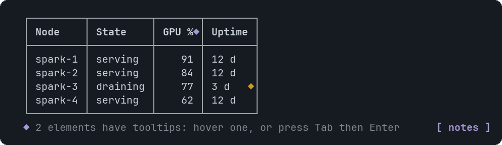</a><br><sub>Table</sub></td>
<td valign="top" width="25%"><a href="docs/components/LineChart.md">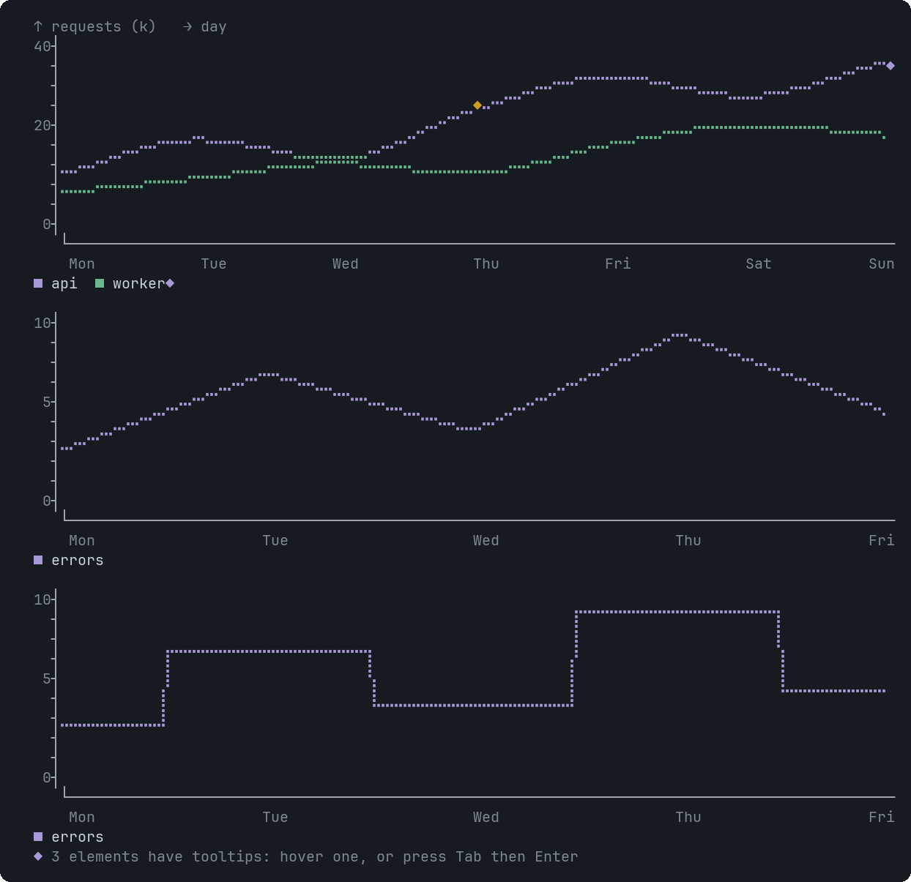</a><br><sub>LineChart</sub></td>
<td valign="top" width="25%"><a href="docs/components/PieChart.md">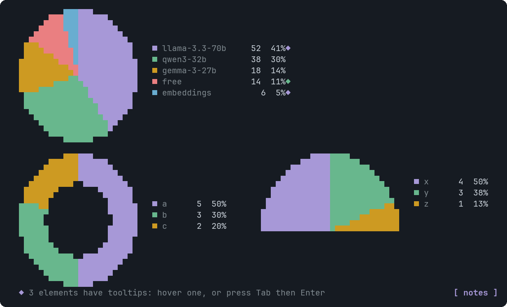</a><br><sub>PieChart</sub></td>
<td valign="top" width="25%"><a href="docs/components/GeoMap.md">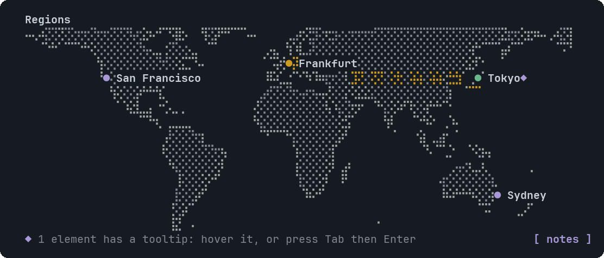</a><br><sub>GeoMap</sub></td>
</tr>
<tr>
<td valign="top"><a href="docs/components/Erd.md">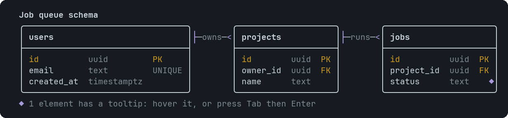</a><br><sub>Erd</sub></td>
<td valign="top"><a href="docs/components/SequenceDiagram.md">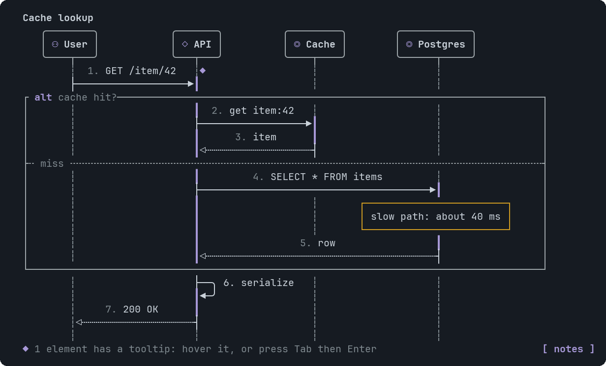</a><br><sub>SequenceDiagram</sub></td>
<td valign="top"><a href="docs/components/CodeBlock.md">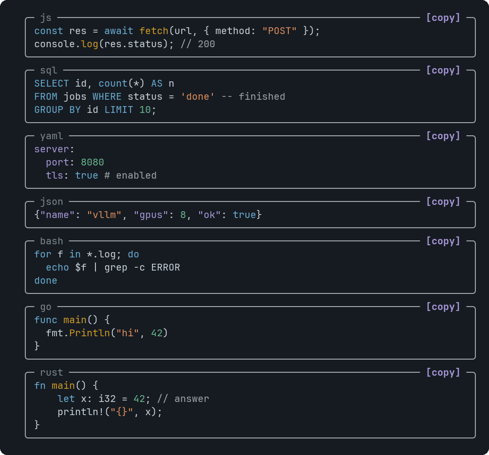</a><br><sub>CodeBlock</sub></td>
<td valign="top"><a href="docs/components/RadarChart.md">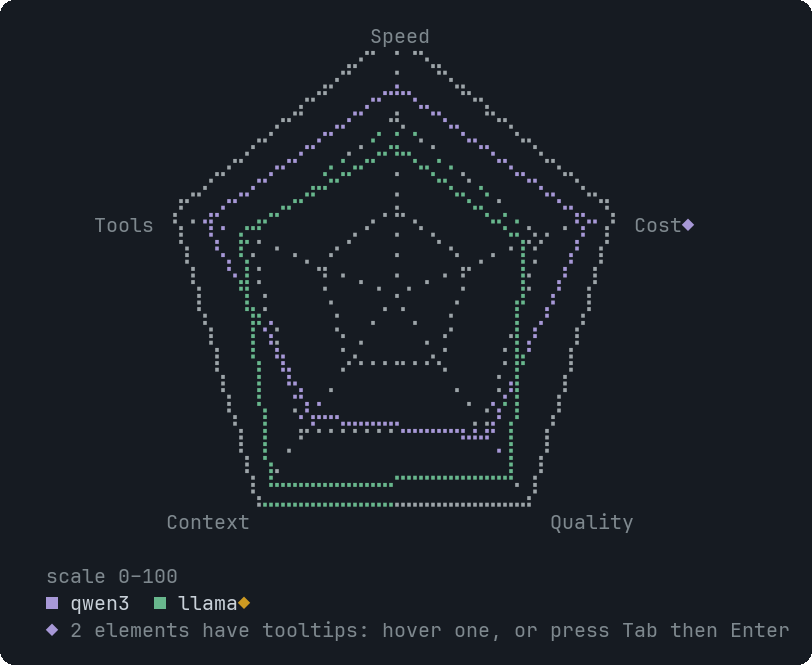</a><br><sub>RadarChart</sub></td>
</tr>
</table>

All 23, with signatures, every argument, a checked example and tips: **[docs/components/](docs/components/README.md)**.

| Group | Components |
|---|---|
| Layout and text | [Stack](docs/components/Stack.md), [Text](docs/components/Text.md), [Card](docs/components/Card.md), [Callout](docs/components/Callout.md) |
| Data | [Metric](docs/components/Metric.md), [Table](docs/components/Table.md) |
| Interactive | [Tabs](docs/components/Tabs.md), [Button](docs/components/Button.md), [Choice](docs/components/Choice.md), [Faq](docs/components/Faq.md) |
| Rich content | [Markdown](docs/components/Markdown.md), [CodeBlock](docs/components/CodeBlock.md), [Image](docs/components/Image.md) |
| Charts | [BarChart](docs/components/BarChart.md), [LineChart](docs/components/LineChart.md), [AreaChart](docs/components/AreaChart.md), [PieChart](docs/components/PieChart.md), [RadarChart](docs/components/RadarChart.md) |
| Diagrams and maps | [Dag](docs/components/Dag.md), [Erd](docs/components/Erd.md), [InfraMap](docs/components/InfraMap.md), [SequenceDiagram](docs/components/SequenceDiagram.md), [GeoMap](docs/components/GeoMap.md) |

[Tooltip](docs/components/Tooltip.md) attaches to Dag, Erd, InfraMap, SequenceDiagram, Table, Metric, BarChart,
LineChart, AreaChart, PieChart, RadarChart, GeoMap and Image.

## How it works

```
OpenUI Lang --parse--> typed tree --render--> blocks (rows of cells + click targets) --> pi-tui lines
                                                     ^                                       |
                                       interaction logic: hit test, keys, panning   <-- mouse and keys
```

- `src/lang/` parses and validates OpenUI Lang with one table of component signatures. The same table writes the reference the
  agent reads and the docs pages you see here.
- `src/blocks/` turns each component into a grid of styled cells plus the places you can click.
- `src/diagram/` is the layout and routing engine for Dag, Erd and InfraMap.
- `src/pi/` is the pi extension: the tool, the commands, the themed component, mouse and keyboard handling, pictures.

More in [docs/design.md](docs/design.md).

## Requirements

- pi 1.4 or newer.
- Node 22.18 or newer for the tests and scripts (they run TypeScript directly). Developed on Node 26.
- A terminal font with the glyphs the widgets use. They were chosen from, and are tested against, JetBrains Mono Nerd Font
  Mono. A different font works if it has them: `PI_OPENUI_FONT=/path/to/font.ttf npm test` checks yours.
- Pictures need a terminal that supports the Kitty graphics protocol. Other terminals get a framed placeholder.

## Development

```sh
npm test                 # a few seconds, no network, no model calls
npm run docs             # regenerate docs/components/ from the signature table
npm run screenshots      # regenerate docs/screenshots/ (needs Python with Pillow, and the font)
npm run gallery          # print every component to the terminal (-- --plain for no colour)
```

Tests are described in [docs/testing.md](docs/testing.md). Releases are described in [docs/releasing.md](docs/releasing.md).
Contributors and agents working in this repository should read [AGENTS.md](AGENTS.md).

## Limits

- Hover needs a terminal that reports mouse movement. The keyboard covers everything else.
- Only Kitty-protocol terminals show pictures. A tooltip attaches to a whole picture, not to a spot inside it.
- Dense graphs of 11 or more nodes can be wider than the terminal. They scroll sideways, and moving focus scrolls the node
  into view.
- The map uses 110m coastlines: country scale, not city scale.
- Widgets are not saved anywhere but pi's own session. A resumed session redraws them from the tool results. Notes are not
  saved at all.
- A widget has size limits (100 KB of source, 100 table rows, 60 graph nodes, 30 map nodes, and so on). Over a limit the
  agent gets an error with the number and fixes it. They keep pi fast: it draws every widget on every frame. See the
  [list](docs/components/README.md#size-limits).

## License

[MIT](LICENSE).
