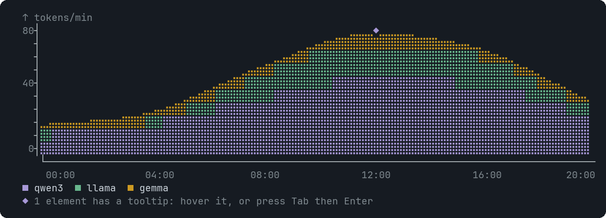

# AreaChart

Like LineChart, but the series are stacked and filled, so it shows parts of a growing total.


<sub>Three stacked series</sub>

## Signature

```text
AreaChart(labels: string[], series: Series[], variant?: "linear" | "natural" | "step", xLabel?: string, yLabel?: string, height?: number, tooltips?: Tooltip[])
Series(category: string, values: number[])
```

## When to use

- Volume or cumulative totals made of several parts: tokens per model.

Not for: Comparing series directly: stacking hides that. Use LineChart.

## Arguments

### AreaChart

| # | Argument | Type | Required | Notes |
|---|---|---|---|---|
| 1 | `labels` | `string[]` | yes | The x categories. |
| 2 | `series` | `Series[]` | yes | One Series each, stacked in order (the first at the bottom). |
| 3 | `variant` | `"linear" \| "natural" \| "step"` | no | `natural` (default), `linear` or `step`. |
| 4 | `xLabel` | `string` | no | Axis caption. |
| 5 | `yLabel` | `string` | no | Axis caption. |
| 6 | `height` | `number` | no | As LineChart. |
| 7 | `tooltips` | `Tooltip[]` | no | As LineChart. The badge sits on the top edge of the stack. |

### Series

| # | Argument | Type | Required | Notes |
|---|---|---|---|---|
| 1 | `category` | `string` | yes | The series name. |
| 2 | `values` | `number[]` | yes | Numbers parallel to the labels. |

## Example

```openui
root = Stack([c])
c = AreaChart(["00:00", "08:00", "16:00"], [a, b])
a = Series("qwen3", [10, 30, 38])
b = Series("llama", [5, 15, 18])
```

## Tooltips

Use an x label (a category) or series:<name>. See [Tooltip](Tooltip.md). Write `null` for each skipped optional argument before `tooltips`, which is always last.

## Tips and pitfalls

- The top line is the total of all series.

## Related

[LineChart](LineChart.md) · [PieChart](PieChart.md)
