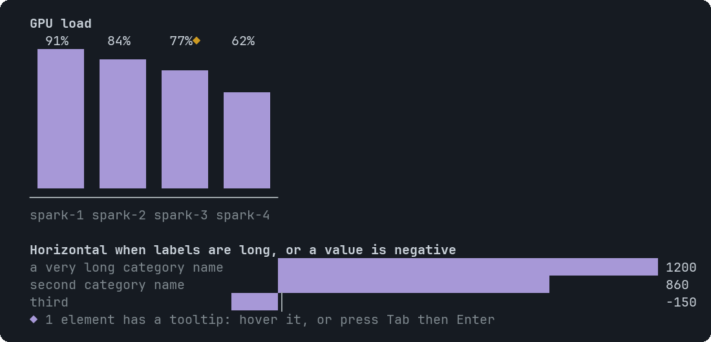

# BarChart

Bars for one series of categories. Vertical when it fits, horizontal otherwise.


<sub>Vertical bars with a tooltip on one bar, then horizontal bars with a negative value</sub>

## Signature

```text
BarChart(labels: string[], values: number[], title?: string, unit?: string, tooltips?: Tooltip[])
```

## When to use

- One value per category: load per node, count per type.

Not for: Trends over time with several series (LineChart) or parts of a whole (PieChart).

## Arguments

### BarChart

| # | Argument | Type | Required | Notes |
|---|---|---|---|---|
| 1 | `labels` | `string[]` | yes | One name per bar. |
| 2 | `values` | `number[]` | yes | Numbers, same length as `labels`. Mixed signs switch to horizontal bars. |
| 3 | `title` | `string` | no | A bold line above the chart. |
| 4 | `unit` | `string` | no | A suffix for the value labels, for example `%`. |
| 5 | `tooltips` | `Tooltip[]` | no | Target: a bar's label. Duplicate labels are ambiguous. Write `null` for `title` and `unit` if you skip them. |

## Example

```openui
root = Stack([c])
c = BarChart(["spark-1", "spark-2", "spark-3"], [91, 84, 77], "GPU load", "%")
```

## Tooltips

Use a bar label. See [Tooltip](Tooltip.md). Write `null` for each skipped optional argument before `tooltips`, which is always last.

## Tips and pitfalls

- Bar heights are drawn to an eighth of a cell, so close values still differ.
- Large values are shortened: 12400 is shown as `12.4k`.

## Related

[LineChart](LineChart.md) · [PieChart](PieChart.md) · [Table](Table.md)
