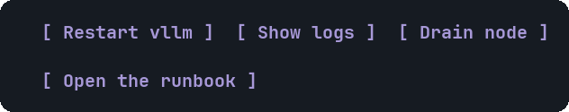

# Button

A clickable button that sends text to the assistant as your next message.


<sub>A plain button, one with an action, and a link button</sub>

## Signature

```text
Button(label: string, action?: action)
```

## When to use

- Offering the next step: Restart, Show logs, Drain node.

## Arguments

### Button

| # | Argument | Type | Required | Notes |
|---|---|---|---|---|
| 1 | `label` | `string` | yes | The text. A button without an action sends this label. |
| 2 | `action` | `action` | no | `@ToAssistant("text")` sends that text (500 characters at most). `Action([...])` holds several steps. `@OpenUrl("https://...")` copies the link to the clipboard, because a terminal cannot open a browser from here. |

## Example

```openui
root = Stack([b])
b = Button("Restart vllm", @ToAssistant("Restart the vllm service on dgx-spark-1"))
```

## Interaction

- In a widget the agent drew, a click (or Enter on the focused button) sends the text as a real user turn. The agent acts, then draws a new widget.
- In `/openui-gallery` the click is only echoed locally, so trying it costs nothing.

## Tips and pitfalls

- Write the action text as a clear instruction: it is what the assistant reads.

## Related

[Choice](Choice.md) · [Faq](Faq.md)
