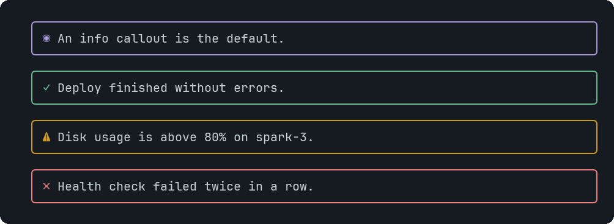

# Callout

A highlighted note with an icon: information, success, a warning or an error.


<sub>The four tones</sub>

## Signature

```text
Callout(text: string, tone?: "info" | "success" | "warn" | "error")
```

## When to use

- Drawing the eye to one fact: a failure, a caveat, a result.

## Arguments

### Callout

| # | Argument | Type | Required | Notes |
|---|---|---|---|---|
| 1 | `text` | `string` | yes | The message. It wraps. |
| 2 | `tone` | `"info" \| "success" \| "warn" \| "error"` | no | `info` (default, ◉), `success` (✓), `warn` (⚠) or `error` (✗). The icon and border take the theme colour for the tone. |

## Example

```openui
root = Stack([a, b])
a = Callout("Disk usage is above 80% on spark-3.", "warn")
b = Callout("Deploy finished without errors.", "success")
```

## Tips and pitfalls

- Keep it to a sentence or two; long text belongs in Markdown.

## Related

[Text](Text.md) · [Markdown](Markdown.md)
