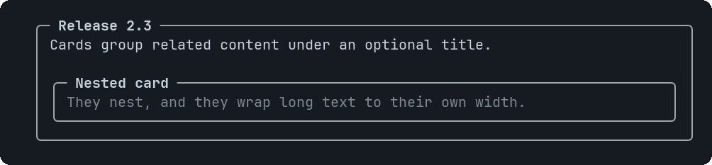

# Card

A bordered panel with an optional title in the top border.


<sub>A card with a nested card</sub>

## Signature

```text
Card(children: component[], title?: string)
```

## When to use

- Giving a chart or table a heading and a frame.
- Separating sections inside one widget.

## Arguments

### Card

| # | Argument | Type | Required | Notes |
|---|---|---|---|---|
| 1 | `children` | `component[]` | yes | The components inside. They are laid out as a column with the default gap. |
| 2 | `title` | `string` | no | Shown in the top border. Cut with an ellipsis if it does not fit. |

## Example

```openui
root = Stack([c])
c = Card([chart], "Load by node")
chart = BarChart(["a", "b", "c"], [3, 5, 2])
```

## Tips and pitfalls

- The content is 4 columns narrower than the card: border and padding on both sides.
- Use Tabs for sections the reader switches between, Cards for sections shown together.

## Related

[Stack](Stack.md) · [Tabs](Tabs.md)
