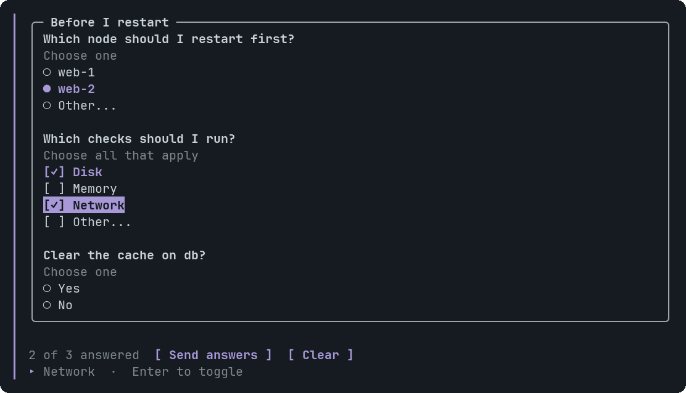
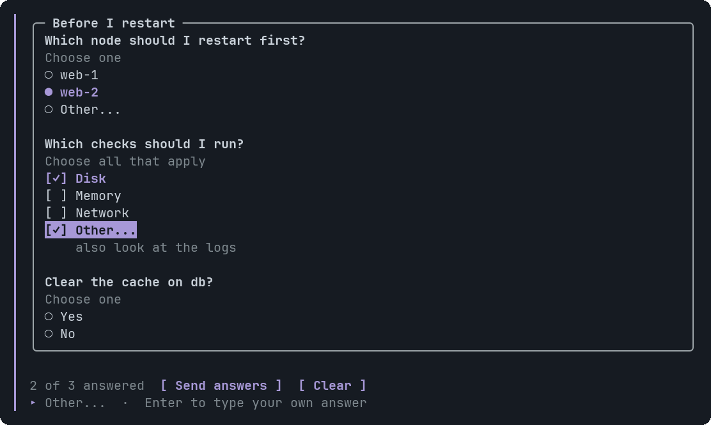
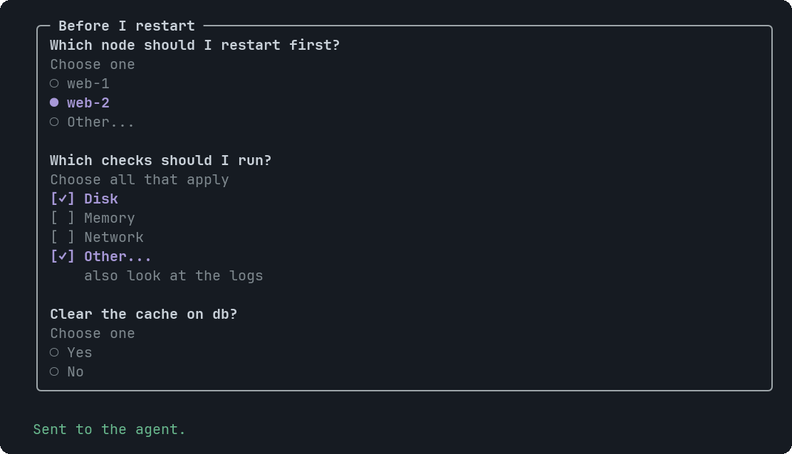

# Choice

A question with a short list of options for you to answer. A click only stages the answer: one **Send answers** button under the widget sends every answer of the widget together, as one message. An option can allow several answers, and every question has an **Other...** row where you type your own.


<sub>One question with a hint: the tag says Choose one, the options have round indicators, Other... is the last row, and the bar counts</sub>


<sub>Three questions in one Card, two answered. The second allows several answers (square indicators); the third has no Other row</sub>


<sub>Other... opens pi's editor. The text you save shows under the row, and selects it</sub>


<sub>After Send answers every question is locked, the chosen rows stay marked, and the bar says so</sub>

## Signature

```text
Choice(question: string, options: string[], hint?: string, multiple?: boolean, other?: boolean)
```

## When to use

- A clarifying question with a few known answers: which node, which environment, yes or no. Ask all of them in ONE widget, in a Card or in Tabs: you answer them together and send once.
- A confirmation before something risky, under a Callout that explains the cost.
- A question where several answers can be right (`multiple`), or where you may want to say something that is not listed (the Other row).

Not for: a command that should run as written. Use a Button with `@ToAssistant`, which sends exactly the text you give it on one click.

## Arguments

### Choice

| # | Argument | Type | Required | Notes |
|---|---|---|---|---|
| 1 | `question` | `string` | yes | Shown in bold above the options. It is also the first half of the answer sent back. It must have text. Limit: 200 characters at most. |
| 2 | `options` | `string[]` | yes | One row per entry, each with an indicator: a round radio for a single question, a square checkbox for `multiple`. Two to six, each at most 120 characters. A long option wraps under its indicator, so you can read everything that is sent. An empty option is an error. Limit: at most 6 items. |
| 3 | `hint` | `string` | no | A muted line between the tag and the options. The tag already says `Choose one` or `Choose all that apply`, so do not repeat that here. |
| 4 | `multiple` | `boolean` | no | `true`: options toggle independently and several can be answered. Default `false`: one answer, and picking another option moves the pick. |
| 5 | `other` | `boolean` | no | Default `true`: a last row, `Other...`, where you type your own answer. `false` hides it. Write `null` for every skipped argument before it: `Choice("Clear the cache?", ["Yes", "No"], null, null, false)`. |

## Example

```openui
root = Stack([plan])
plan = Card([q1, q2, q3], "Before I restart")
q1 = Choice("Which node should I restart first?", ["web-1", "web-2"])
q2 = Choice("Which checks should I run?", ["Disk", "Memory", "Network"], null, true)
q3 = Choice("Clear the cache on db?", ["Yes", "No"], null, null, false)
```

Three questions in one widget: one bar counts and sends them. `null` skips `hint`, and the third question turns the Other row off.

Answered as in the last screenshot above (web-2, Disk, and the words `also look at the logs`, with the third question skipped), the agent receives this one message:

```text
Answers to the questions in widget `Before I restart` (3):

1. Which node should I restart first?
   web-2
2. Which checks should I run?
   Disk; other: also look at the logs
3. Clear the cache on db?
   (no answer)
```

The widget is named, in backticks, by the first title or heading in it. The words you type in Other are sent as typed. The question and option words come from the agent, so before they go out control and invisible characters are removed, whitespace is collapsed, and anything that could attach a file or run a command is defused: `@file:x` becomes `(at)file:x`, and a single question that starts like a command, such as `/new session?`, uses the numbered list.

## Interaction

- Click an option, or move with the arrow keys and press Enter. Nothing is sent. In a single question a second click on the chosen option clears it and another option moves the pick; in a `multiple` question each option toggles on its own.
- Click Other... (or Enter on it). pi's own editor opens with the question as its title: Enter saves, Shift+Enter adds a line, Esc leaves the answer as it was. Saved text selects the row (a single question drops the option, a `multiple` one keeps its options); saving empty text unselects it. The text shows under the row, up to two lines (a line break shows as a ¶). A tab becomes a space, and a run of blank lines becomes one.
- The bar under the widget reads `N of M answered`. It counts every question, also those on a tab you have not opened. **[ Send answers ]** is live once one question is answered; **[ Clear ]** drops every staged answer. Down from the last option reaches Send answers, never Clear.
- Send answers sends one message and locks every question. The chosen rows stay marked and the bar says `Sent to the agent.` A locked widget cannot be answered again, and it gives the keyboard back to pi, so Enter sends your own message. The agent draws a new widget to ask again.
- In notes mode the options, Other and the bar do nothing, like a Button.

## Tips and pitfalls

- This changed from earlier versions: a click used to send `<question> — <option>` at once. Now nothing is sent until Send answers, and a Choice written for the old behaviour gets an Other row and the bar. Write `other: false` to keep a closed list.
- The message for ONE single question answered with an option is still the line `<question> — <option>`, for example `Which node should I restart first? — web-2`. Anything else is a numbered list, with `(no answer)` for a question you skipped and `other: ...` for typed text (shown under the example).
- Ask everything in one widget. A second widget has its own bar and sends its own message.
- Write the question and options so `<question> — <option>` still reads as a sentence: "Clear the cache on db? — Yes, clear it" works; "Are you sure? — OK" does not say what was agreed.
- `(no answer)` means skipped. Do not read it as a "no".
- Options are plain text: no icons, links or per-option descriptions. Put detail in the hint or the question.
- At most 12 questions per widget, 6 options each. A widget that was written for the old behaviour keeps working unless it breaks one of the new limits (a question over 200 characters, an option over 120, more than 12 questions), which is an error the agent is told about.
- The answers live in memory with the widget. They are gone when the session ends or pi restarts, and a widget redrawn from a resumed session opens unanswered, with Send answers live again even if it was sent before.
- The bar says `Sending to the agent…` until pi reports that it took the message, then `Sent to the agent.` If pi cannot take it (no model selected, no credentials), pi shows its own error, and after 3 seconds the widget is given back with your answers and Send answers works again.

## Related

[Button](Button.md) · [Callout](Callout.md) · [Card](Card.md) · [Tabs](Tabs.md)
