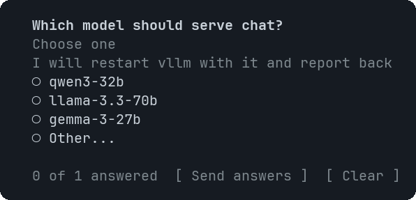

# Choice

A question with clickable options for you to answer.


<sub>Options on one line when they fit, stacked when they do not</sub>

## Signature

```text
Choice(question: string, options: string[], hint?: string)
```

## When to use

- Asking a clarifying question instead of guessing.

## Arguments

### Choice

| # | Argument | Type | Required | Notes |
|---|---|---|---|---|
| 1 | `question` | `string` | yes | The question. |
| 2 | `options` | `string[]` | yes | Two to six short answers. Limit: at most 6 items. |
| 3 | `hint` | `string` | no | A line of explanation under the question. |

## Example

```openui
root = Stack([q])
q = Choice("Which model should serve chat?", ["qwen3-32b", "llama-3.3-70b"], "Pick one")
```

## Interaction

- Click an option, or move with the arrow keys and press Enter. The pick is filled (●) and `<question> — <option>` is sent as your next message.

## Tips and pitfalls

- You can change the pick; each click sends a new message.

## Related

[Button](Button.md)
