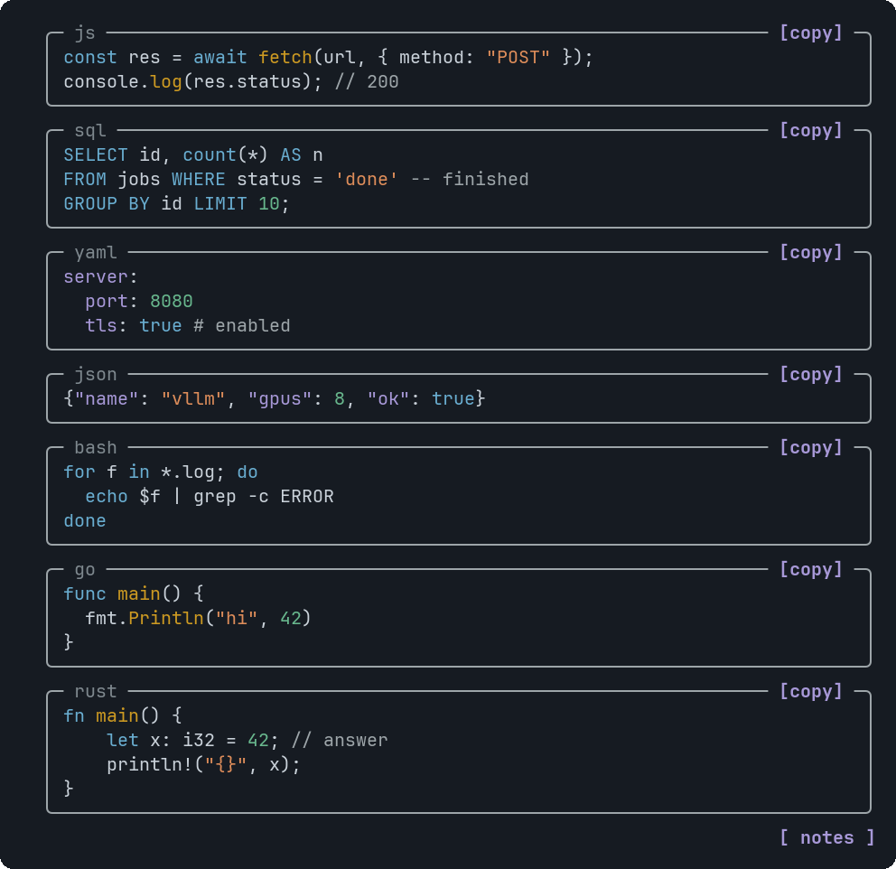

# CodeBlock

Syntax-highlighted code in a frame, with a copy button.


<sub>Highlighting for JavaScript, SQL, YAML, JSON, bash, Go and Rust</sub>

## Signature

```text
CodeBlock(code: string, language?: string, title?: string)
```

## When to use

- Commands to run, config to paste, a query.

## Arguments

### CodeBlock

| # | Argument | Type | Required | Notes |
|---|---|---|---|---|
| 1 | `code` | `string` | yes | The source. Use `\n` for new lines. Tabs become two spaces; more than 200 lines are cut. Limit: 30,000 characters at most. |
| 2 | `language` | `string` | no | `python`, `js` (also ts, jsx, tsx), `bash` (sh, zsh), `sql`, `yaml`, `json`, `go` or `rust`. Anything else is shown plain. |
| 3 | `title` | `string` | no | A file name or caption in the top border, shown with the language. |

## Example

```openui
root = Stack([c])
c = CodeBlock("kubectl rollout restart deploy/api\nkubectl rollout status deploy/api", "bash", "restart.sh")
```

## Interaction

- Click `[copy]` (or Tab to it and press Enter) to put the exact code on the clipboard with an OSC 52 escape. The label changes to `✓ copied` for two seconds.

## Tips and pitfalls

- Long lines are cut with an ellipsis, not wrapped, so the code stays aligned. The copy still has the full line.
- The clipboard needs a terminal that accepts OSC 52 (most modern ones do).

## Related

[Markdown](Markdown.md)
