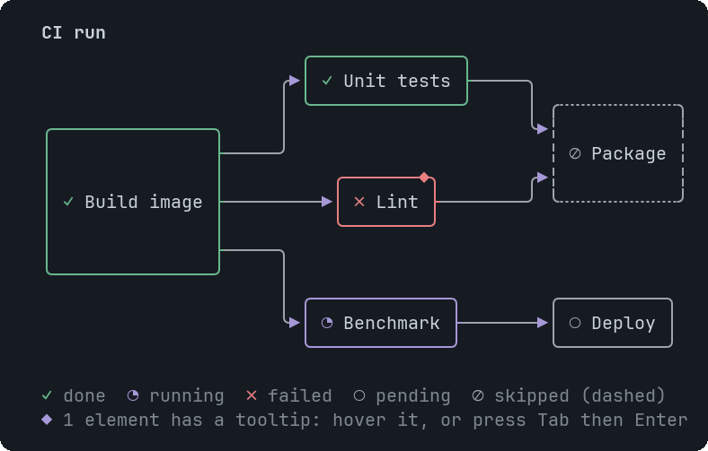
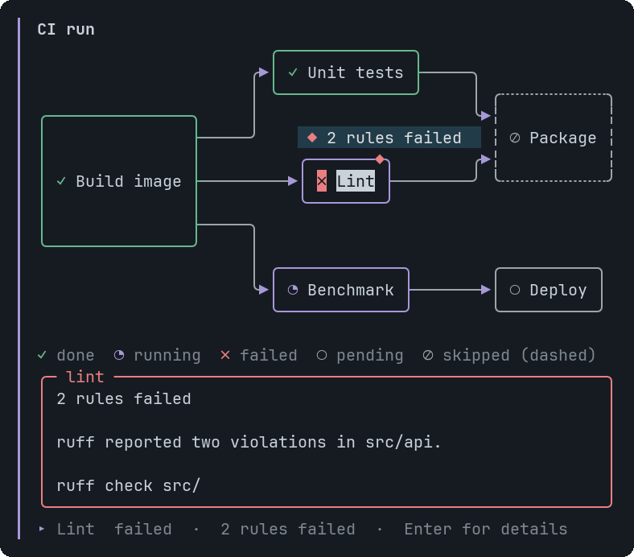

# Dag

A directed graph with an automatic layered layout, for pipelines, task graphs and dependencies.


<sub>A CI run with every status: done, failed, running, skipped and pending</sub>


<sub>A focused node: bold accent border, hint bubble, and the tooltip panel below</sub>

## Signature

```text
Dag(nodes: DagNode[], edges: string[][], direction?: "LR" | "TB", title?: string, tooltips?: Tooltip[])
DagNode(id: string, label: string, status?: "done" | "running" | "failed" | "pending" | "skipped")
```

## When to use

- A pipeline where each step has a state.
- A fan-out and fan-in.
- Which job waits for which.

Not for: Database tables (Erd) or a plain list of steps (Table).

## Arguments

### Dag

| # | Argument | Type | Required | Notes |
|---|---|---|---|---|
| 1 | `nodes` | `DagNode[]` | yes | One DagNode per box. |
| 2 | `edges` | `string[][]` | yes | `[fromId, toId]` pairs. Use the id strings, not the variable names. An id with no node is a validation error. |
| 3 | `direction` | `"LR" \| "TB"` | no | `LR` (left to right) or `TB` (top to bottom). Leave it out or pass `null` for automatic: left to right when it fits, otherwise top to bottom. |
| 4 | `title` | `string` | no | A bold line above the graph. |
| 5 | `tooltips` | `Tooltip[]` | no | Target: a node id. |

### DagNode

| # | Argument | Type | Required | Notes |
|---|---|---|---|---|
| 1 | `id` | `string` | yes | Unique in the graph. Edges refer to it. |
| 2 | `label` | `string` | yes | The text in the box. Shortened with an ellipsis when space is tight. |
| 3 | `status` | `"done" \| "running" \| "failed" \| "pending" \| "skipped"` | no | `done` ✓, `running` ◔, `failed` ✗, `pending` ○ or `skipped` ⊘ (also a dashed box). Omit it for a plain box. A legend names the statuses in use. |

## Example

```openui
root = Stack([flow])
flow = Dag([a, b, c], [["build", "test"], ["test", "deploy"]], null, "Release")
a = DagNode("build", "Build", "done")
b = DagNode("test", "Test", "running")
c = DagNode("deploy", "Deploy", "pending")
```

## Interaction

- Each node is a target: hover, Tab or arrows move between them, and a tooltip opens on click or Enter.

## Tooltips

Use a DagNode id. See [Tooltip](Tooltip.md). Write `null` for each skipped optional argument before `tooltips`, which is always last.

## Tips and pitfalls

- A cycle is allowed: the edge that closes it is drawn dashed, pointing back.
- Every edge has its own wire, wires cross only at right angles (`┼`), and the layout is checked by decoding the picture back into edges. An edge that truly cannot be routed is left out and listed under the graph as `a -> b (not drawn)`.
- Wider than the terminal: labels shrink first, then the direction switches, then the view scrolls sideways.

## Related

[Erd](Erd.md) · [InfraMap](InfraMap.md) · [SequenceDiagram](SequenceDiagram.md)
