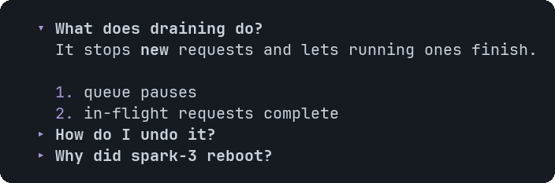

# Faq

A list of questions that expand to show their answers.


<sub>The first answer is open</sub>

## Signature

```text
Faq(items: FaqItem[], firstOpen?: boolean)
FaqItem(question: string, answer: string)
```

## When to use

- Reference material the reader opens on demand.

## Arguments

### Faq

| # | Argument | Type | Required | Notes |
|---|---|---|---|---|
| 1 | `items` | `FaqItem[]` | yes | One FaqItem per question. |
| 2 | `firstOpen` | `boolean` | no | `true` opens the first answer at the start. |

### FaqItem

| # | Argument | Type | Required | Notes |
|---|---|---|---|---|
| 1 | `question` | `string` | yes | The heading. |
| 2 | `answer` | `string` | yes | Markdown: lists, bold, code and tables all work. |

## Example

```openui
root = Stack([f])
f = Faq([a, b], true)
a = FaqItem("What does draining do?", "It stops **new** requests.\n\n1. queue pauses\n2. running requests finish")
b = FaqItem("How do I undo it?", "Run `uncordon`.")
```

## Interaction

- Click a question, or Tab to it and press Enter, to open or close it. Each item toggles on its own.

## Tips and pitfalls

- Open answers push the content below them down.

## Related

[Markdown](Markdown.md) · [Tabs](Tabs.md)
