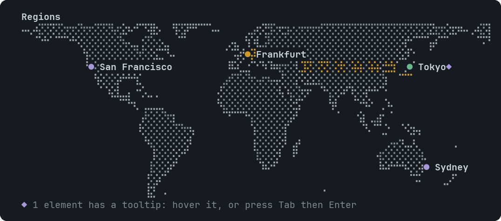
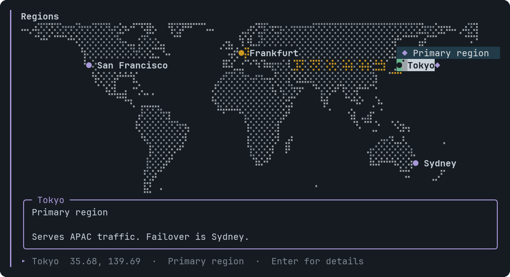

# GeoMap

An offline world map zoomed to fit your pins, with optional dashed links.


<sub>Four pins and one link on country-scale coastlines</sub>


<sub>A pin's tooltip panel (click or Enter)</sub>

## Signature

```text
GeoMap(points: GeoPoint[], links?: string[][], title?: string, tooltips?: Tooltip[])
GeoPoint(label: string, lat: number, lon: number, tone?: "good" | "warn" | "bad" | "info" | "neutral")
```

## When to use

- Where regions, offices or servers are.

Not for: City-level detail: the coastlines are 110m, country scale.

## Arguments

### GeoMap

| # | Argument | Type | Required | Notes |
|---|---|---|---|---|
| 1 | `points` | `GeoPoint[]` | yes | One GeoPoint per pin. |
| 2 | `links` | `string[][]` | no | Optional `[labelA, labelB]` pairs drawn dashed. |
| 3 | `title` | `string` | no | A bold line above the map. |
| 4 | `tooltips` | `Tooltip[]` | no | Targets: a point's label, or `A>B` for a link. |

### GeoPoint

| # | Argument | Type | Required | Notes |
|---|---|---|---|---|
| 1 | `label` | `string` | yes | The pin's name. Unique within the map. |
| 2 | `lat` | `number` | yes | Decimal degrees, -90 to 90. |
| 3 | `lon` | `number` | yes | Decimal degrees, -180 to 180. |
| 4 | `tone` | `"good" \| "warn" \| "bad" \| "info" \| "neutral"` | no | Colours the pin: `good`, `warn`, `bad`, `info` (default) or `neutral`. |

## Example

```openui
root = Stack([m])
m = GeoMap([a, b], [["Tokyo", "Frankfurt"]], "Regions")
a = GeoPoint("Tokyo", 35.68, 139.69, "good")
b = GeoPoint("Frankfurt", 50.11, 8.68, "warn")
```

## Tooltips

Use a GeoPoint label, or A>B for a link. See [Tooltip](Tooltip.md). Write `null` for each skipped optional argument before `tooltips`, which is always last.

## Tips and pitfalls

- The land is dotted and its coast is drawn solid; the map uses a plain equirectangular projection, with square dots.
- A pin whose label has no room is listed under the map as `also: ...`.

## Related

[InfraMap](InfraMap.md)
