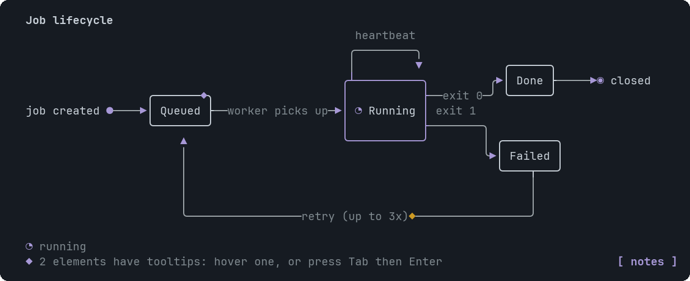
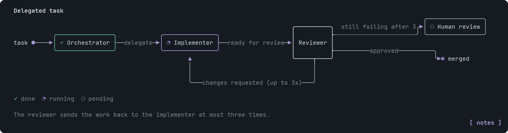
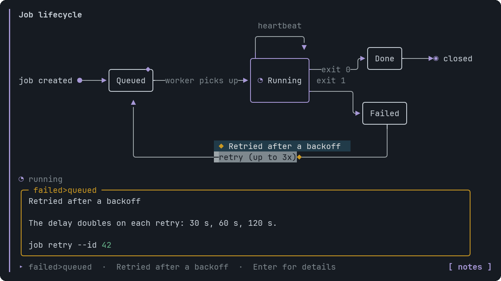
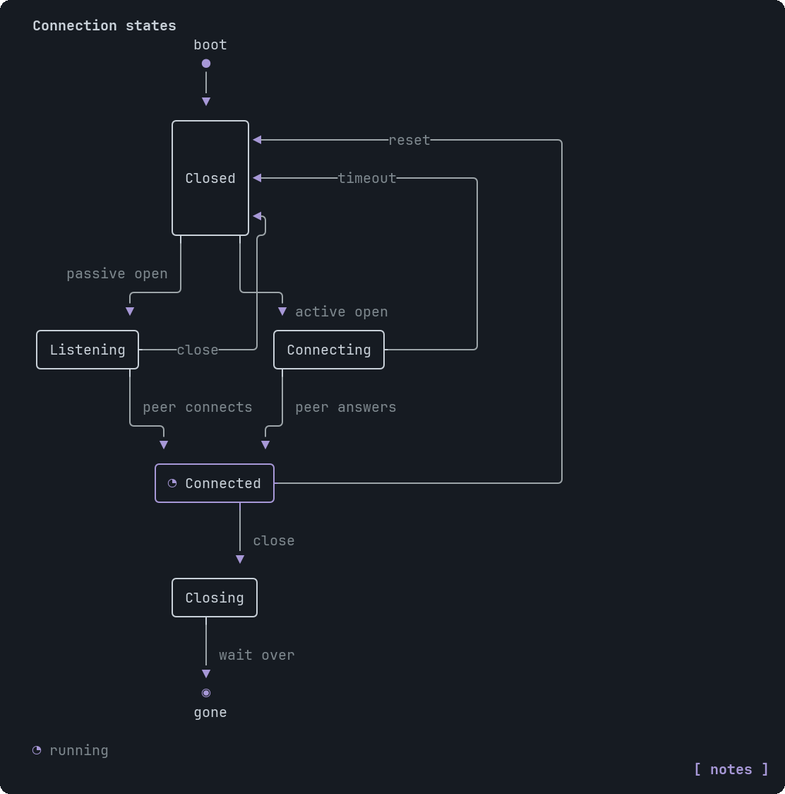
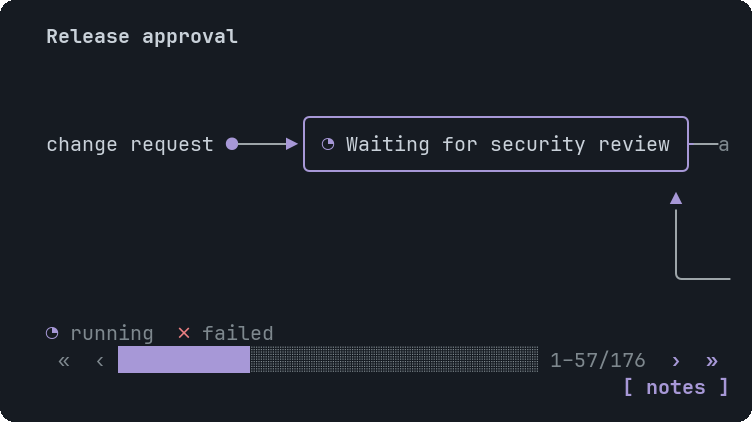

# Graph

A directed graph that may have loops, with a label on every arrow: state machines, and review or retry loops such as an implementer and a reviewer, up to 3 times.


<sub>A job lifecycle: a start dot, an end ring, a retry arc below the graph, a self-loop above Running, and a status on the current state</sub>


<sub>An agent that delegates to an implementer and a reviewer, on a wide pane: the arrow back is an arc below the graph, and the dashed edge is the escape after three rounds</sub>


<sub>A tooltip on an edge: the badge sits on the edge's label, and the panel opens under the graph</sub>


<sub>A busy state machine drawn top to bottom: the three arrows back into Closed run in lanes on the right</sub>


<sub>Long state names and edge labels on a 60-column pane, forced left to right: it scrolls sideways with whole labels (the pan bar), and the arc back scrolls with it</sub>

## Signature

```text
Graph(nodes: GraphNode[], edges: GraphEdge[], direction?: "LR" | "TB", title?: string, tooltips?: Tooltip[])
GraphNode(id: string, label: string, kind?: "state" | "start" | "end", status?: "done" | "running" | "failed" | "pending" | "skipped")
GraphEdge(from: string, to: string, label?: string, style?: "solid" | "dashed")
```

## When to use

- A state machine: the states of a job, an order or a connection, with the event on each arrow.
- A loop that runs a bounded number of times: a reviewer sending work back to an implementer, or a retry after a failure.
- A step that can repeat itself (a self-loop), or two steps that hand work to each other.

Not for: A pipeline with no loops (Dag), calls over time between systems (SequenceDiagram), tables (Erd) or servers in zones (InfraMap).

## Arguments

### Graph

| # | Argument | Type | Required | Notes |
|---|---|---|---|---|
| 1 | `nodes` | `GraphNode[]` | yes | One GraphNode per state. At least one, at most 16. Limit: at most 16 items. |
| 2 | `edges` | `GraphEdge[]` | yes | One GraphEdge per arrow, at most 32. Write `GraphEdge("a", "b", "label")`, not the `["a", "b"]` pairs of Dag. May be empty. Limit: at most 32 items. |
| 3 | `direction` | `"LR" \| "TB"` | no | `LR` (left to right) or `TB` (top to bottom). Leave it out or pass `null` for automatic: left to right when it fits, otherwise top to bottom. |
| 4 | `title` | `string` | no | A bold line above the graph. |
| 5 | `tooltips` | `Tooltip[]` | no | Targets: a node id, or `from>to` for an edge, for example `failed>queued`. Two edges between the same pair share that target, so a tooltip cannot name one of them: put it on a node, or keep one edge for the pair. |

### GraphNode

| # | Argument | Type | Required | Notes |
|---|---|---|---|---|
| 1 | `id` | `string` | yes | Unique in the graph. Edges refer to it: use the id string, not the variable name. |
| 2 | `label` | `string` | yes | The text of the node, 28 characters at most. For a start or an end it is drawn beside the dot. Limit: 28 characters at most. |
| 3 | `kind` | `"state" \| "start" \| "end"` | no | `state` (the default) is a rounded box. `start` is a filled dot `●` where the flow begins: edges leave it and none enters it. `end` is a ring `◉` where it finishes: edges enter it and none leaves it. Give each its own node. The state you return to is a normal state with a separate start dot pointing at it, not a `start` node. A dot is one cell, so an arrow always touches it, from any side; a dot with more than three wires is drawn as a box. |
| 4 | `status` | `"done" \| "running" \| "failed" \| "pending" \| "skipped"` | no | `done` ✓, `running` ◔, `failed` ✗, `pending` ○ or `skipped` ⊘ (also a dashed box). Use it to mark the current state or the progress; a legend names the statuses in use. A dot takes no status. |

### GraphEdge

| # | Argument | Type | Required | Notes |
|---|---|---|---|---|
| 1 | `from` | `string` | yes | The id of the node the arrow leaves. |
| 2 | `to` | `string` | yes | The id of the node it enters. The same id as `from` makes a self-loop. |
| 3 | `label` | `string` | no | Drawn on the arrow: the event or the condition, 32 characters at most. Limit: 32 characters at most. |
| 4 | `style` | `"solid" \| "dashed"` | no | `solid` (the default) or `dashed`, for an optional step. |

## Example

```openui
root = Stack([g])
g = Graph([s, impl, rev, e], [e1, e2, e3, e4], null, "Implementer and reviewer")
s = GraphNode("s", "task", "start")
impl = GraphNode("impl", "Implementer", null, "running")
rev = GraphNode("rev", "Reviewer")
e = GraphNode("e", "merged", "end")
e1 = GraphEdge("s", "impl")
e2 = GraphEdge("impl", "rev", "ready for review")
e3 = GraphEdge("rev", "impl", "changes requested (up to 3x)")
e4 = GraphEdge("rev", "e", "approved")
```

## Interaction

- Each node and each labelled edge is a target: hover, Tab or arrows move between them, and a tooltip opens on click or Enter.
- In notes mode a note on an edge reads `edge `failed` > `queued`, "retry (up to 3x)"`.

## Tooltips

Use a GraphNode id, or <fromId>><toId> for an edge (one edge between the pair). See [Tooltip](Tooltip.md). Write `null` for each skipped optional argument before `tooltips`, which is always last.

## Tips and pitfalls

- The nodes are placed from the arrows that go forward. An arrow that goes back to an earlier node is drawn as an arc in a lane of its own below the graph (to the right of it when the graph runs top to bottom), so a loop never cuts through the picture. List the first state first, or give it `kind` `"start"`, so the loop reads from left to right.
- A self-loop sits above its node (to its left when top to bottom). Two edges between one pair leave apart, up to 6 each way; the same `from`, `to` and `label` twice is an error.
- Wider than the terminal: labels shrink first (never below 14 characters), then the direction switches, then the view scrolls sideways with whole labels. The lanes scroll with the graph.
- Every edge has its own wire and wires cross only at right angles (`┼`). A label that finds no room beside its wire becomes a number on the wire and a footnote under the graph.
- A caption stands on the side of a dot that the flow does not use: before a start dot and after an end ring, or above and below when the graph runs top to bottom.
- Nothing in a graph sends anything to the agent: a tooltip only shows text.

## Related

[Dag](Dag.md) · [SequenceDiagram](SequenceDiagram.md) · [InfraMap](InfraMap.md)
