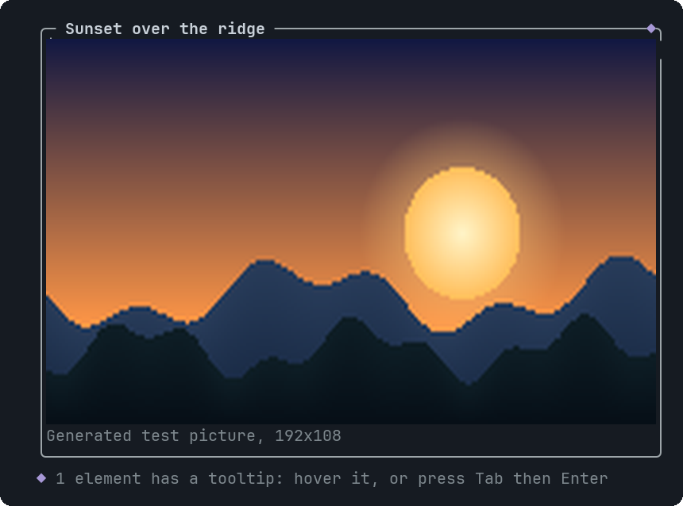
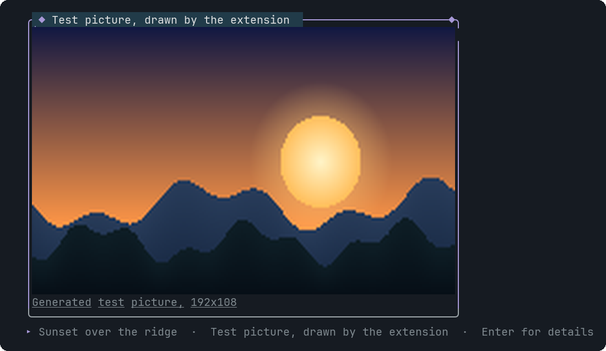

# Image

A picture, drawn for real in terminals that support images, framed, with an optional caption and tooltip.


<sub>A picture inside its frame (generated in code, so the example needs no file)</sub>


<sub>Hovering shows the tooltip hint; the frame lights up</sub>

## Signature

```text
Image(src: string, alt?: string, caption?: string, tooltips?: Tooltip[])
```

## When to use

- A screenshot or diagram the agent produced.
- Anything where a picture says it better than a chart.

## Arguments

### Image

| # | Argument | Type | Required | Notes |
|---|---|---|---|---|
| 1 | `src` | `string` | yes | An absolute path, `~/...`, a path relative to the working directory, or a base64 `data:` URI. PNG, JPEG, GIF or WebP, up to 12 MB. SVG and web URLs are not supported. |
| 2 | `alt` | `string` | no | A short name, shown in the frame's top border. |
| 3 | `caption` | `string` | no | A line under the picture. |
| 4 | `tooltips` | `Tooltip[]` | no | One at most, aimed at the word `image`. |

## Example

```openui
root = Stack([i])
i = Image("/Users/me/Desktop/dashboard.png", "Cluster dashboard", "Taken after the deploy", [t])
t = Tooltip("image", "Screenshot at 14:02", "Taken right after the deploy finished.")
```

The path must exist when the widget is drawn: a missing file is reported to the assistant as an error so it can fix it.

## Interaction

- Hover or Tab to it: the frame turns bold and accent-coloured and the hint bubble appears. Click or Enter opens the tooltip panel.

## Tooltips

Use the word image. See [Tooltip](Tooltip.md). Write `null` for each skipped optional argument before `tooltips`, which is always last.

## Tips and pitfalls

- Pictures use the Kitty graphics protocol: Kitty, Ghostty, WezTerm, Warp and herdr. Elsewhere the frame shows the file name, size and format instead. `PI_IMAGE_PROTOCOL=none` forces that.
- pi-tui sizes the picture (at most 64 columns by 22 rows, scaled down to fit) and pi crops it when you scroll, so it behaves like pi's own images.
- JPEG, GIF and WebP are converted by pi after startup. For a moment they may show the frame, then the picture.
- A tooltip belongs to the whole picture, not to a spot inside it.

## Related

[Tooltip](Tooltip.md) · [Card](Card.md)
