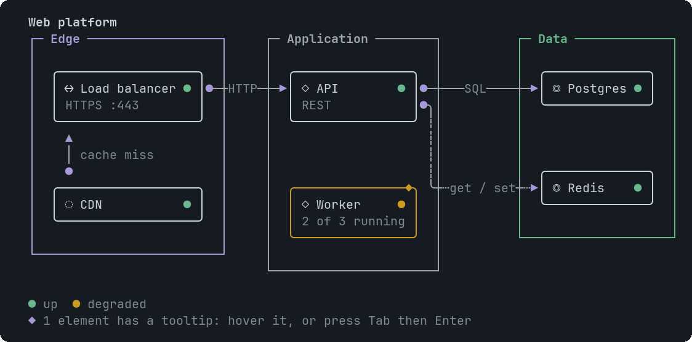

# InfraMap

Zones holding nodes (servers, databases, queues), with labelled arrows showing which talks to which.


<sub>Three zones, with a degraded worker and a dashed link</sub>

## Signature

```text
InfraMap(zones: InfraZone[], links: InfraLink[], title?: string, direction?: "LR" | "TB", tooltips?: Tooltip[])
InfraZone(name: string, nodes: InfraNode[], tone?: "neutral" | "info" | "good" | "warn" | "bad")
InfraNode(id: string, label: string, kind?: "client" | "gateway" | "service" | "gpu" | "database" | "storage" | "queue" | "cloud", status?: "up" | "degraded" | "down" | "unknown", detail?: string)
InfraLink(from: string, to: string, label?: string, style?: "solid" | "dashed")
```

## When to use

- How a system fits together.
- Where a fault is: nodes carry a status.

Not for: More than about 4 zones and 12 nodes: split it in two.

## Arguments

### InfraMap

| # | Argument | Type | Required | Notes |
|---|---|---|---|---|
| 1 | `zones` | `InfraZone[]` | yes | One InfraZone per box, in order. |
| 2 | `links` | `InfraLink[]` | yes | One InfraLink per arrow (`[]` for none). |
| 3 | `title` | `string` | no | A bold line above the map. |
| 4 | `direction` | `"LR" \| "TB"` | no | `"LR"` makes each zone a column (default); `"TB"` makes each zone a row. |
| 5 | `tooltips` | `Tooltip[]` | no | Targets: a node id, `zone:<zone name>`, or `<fromId>><toId>` for a link. |

### InfraZone

| # | Argument | Type | Required | Notes |
|---|---|---|---|---|
| 1 | `name` | `string` | yes | The caption in the top border. |
| 2 | `nodes` | `InfraNode[]` | yes | At least one InfraNode. |
| 3 | `tone` | `"neutral" \| "info" \| "good" \| "warn" \| "bad"` | no | Tints the zone: `neutral` (default), `info`, `good`, `warn`, `bad`. |

### InfraNode

| # | Argument | Type | Required | Notes |
|---|---|---|---|---|
| 1 | `id` | `string` | yes | Unique across the whole map. Links use it. |
| 2 | `label` | `string` | yes | Bold text in the box. |
| 3 | `kind` | `"client" \| "gateway" \| "service" \| "gpu" \| "database" \| "storage" \| "queue" \| "cloud"` | no | Picks the icon: client □, gateway ↔, service ◇, gpu ⌸, database ◎, storage ☰, queue ≡, cloud ◌. |
| 4 | `status` | `"up" \| "degraded" \| "down" \| "unknown"` | no | `up` (green dot), `degraded` (amber), `down` (red) or `unknown` (hollow, dashed box). Omit it for no dot. |
| 5 | `detail` | `string` | no | A short second line, such as a port or a count. |

### InfraLink

| # | Argument | Type | Required | Notes |
|---|---|---|---|---|
| 1 | `from` | `string` | yes | The id of the node where the arrow starts (marked with a dot). |
| 2 | `to` | `string` | yes | The id of the node where it ends (the arrowhead). |
| 3 | `label` | `string` | no | A protocol or purpose such as `SQL`, written on the line. |
| 4 | `style` | `"solid" \| "dashed"` | no | `solid` (default) or `dashed` for an optional or indirect path. |

## Example

```openui
root = Stack([m])
m = InfraMap([edge, app], [l], "Platform")
edge = InfraZone("Edge", [lb], "info")
app = InfraZone("App", [api])
lb = InfraNode("lb", "Load balancer", "gateway", "up", "HTTPS :443")
api = InfraNode("api", "API", "service", "degraded", "2 of 3 running")
l = InfraLink("lb", "api", "HTTP")
```

## Tooltips

Use an InfraNode id, zone:<zone name>, or <fromId>><toId> for a link. See [Tooltip](Tooltip.md). Write `null` for each skipped optional argument before `tooltips`, which is always last.

## Tips and pitfalls

- Zones, nodes and links are each tooltip targets.
- Wires may cross a zone border at a right angle but never run along it.

## Related

[Dag](Dag.md) · [SequenceDiagram](SequenceDiagram.md) · [GeoMap](GeoMap.md)
