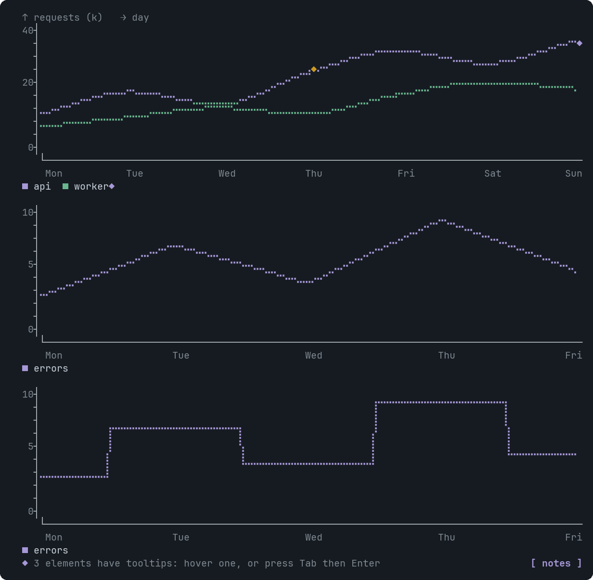
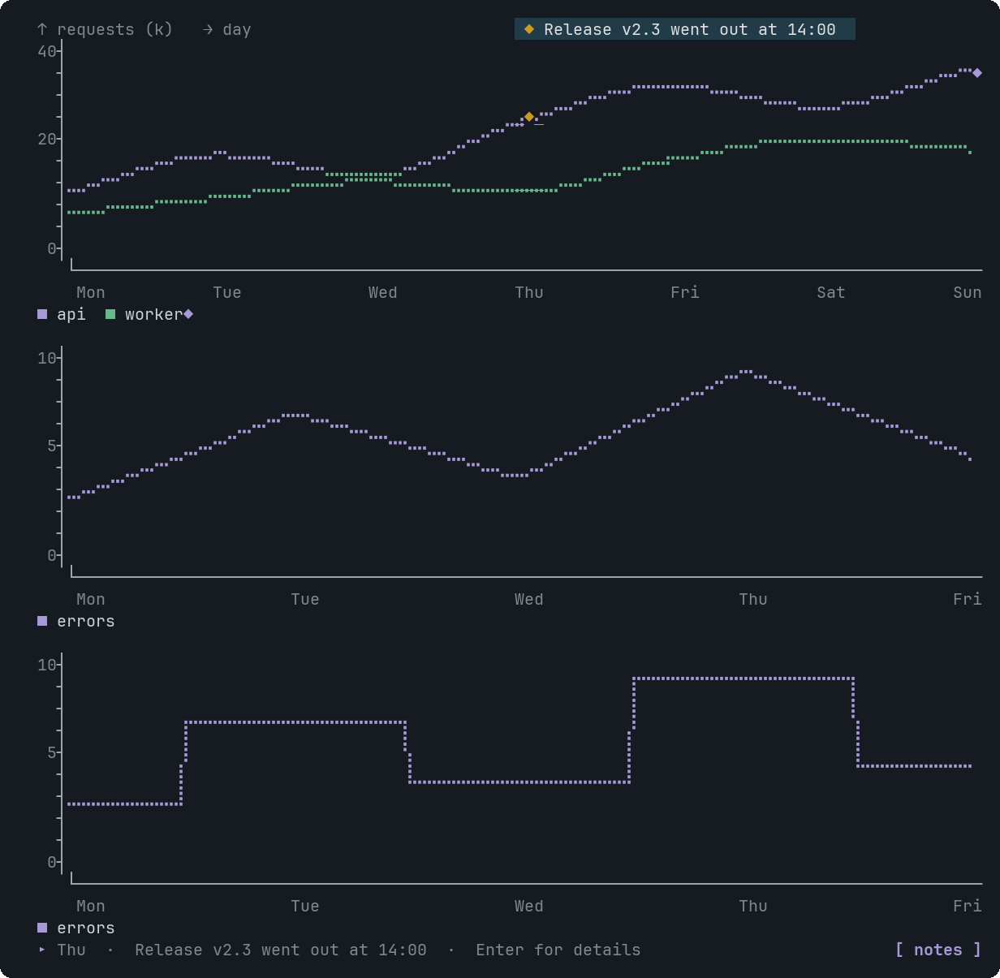

# LineChart

Lines over categories, one per series, drawn with braille dots.


<sub>A smooth two-series chart, then a linear and a step chart</sub>


<sub>Hovering the Thu column: the ◆ sits on the curve at that point</sub>

## Signature

```text
LineChart(labels: string[], series: Series[], variant?: "linear" | "natural" | "step", xLabel?: string, yLabel?: string, height?: number, tooltips?: Tooltip[])
Series(category: string, values: number[])
```

## When to use

- Trends with several series: requests per day, latency per hour.

## Arguments

### LineChart

| # | Argument | Type | Required | Notes |
|---|---|---|---|---|
| 1 | `labels` | `string[]` | yes | The x categories, in order. Limit: at most 200 items. |
| 2 | `series` | `Series[]` | yes | One Series each. Every series needs one value per label. Limit: at most 8 items. |
| 3 | `variant` | `"linear" \| "natural" \| "step"` | no | `natural` (smooth, default, never overshoots), `linear`, or `step`. |
| 4 | `xLabel` | `string` | no | Axis caption, shown as `→ day`. |
| 5 | `yLabel` | `string` | no | Axis caption, shown as `↑ requests`. |
| 6 | `height` | `number` | no | Roughly in pixels; one terminal row is about 20. Default 200 (10 rows), limited to 6-16 rows. |
| 7 | `tooltips` | `Tooltip[]` | no | Targets: an x label (that point, hoverable over its whole column) or `series:<name>` (its legend entry). |

### Series

| # | Argument | Type | Required | Notes |
|---|---|---|---|---|
| 1 | `category` | `string` | yes | The series name, shown in the legend. |
| 2 | `values` | `number[]` | yes | Numbers parallel to the chart's labels. Limit: at most 200 items. |

## Example

```openui
root = Stack([c])
c = LineChart(["Mon", "Tue", "Wed", "Thu", "Fri"], [api, jobs], "natural", null, null, null, [t])
api = Series("api", [12, 19, 15, 32, 28])
jobs = Series("worker", [8, 11, 14, 12, 18])
t = Tooltip("Thu", "Release v2.3 went out", "Traffic jumped 60% after the release.")
```

## Tooltips

Use an x label (a category) or series:<name>. See [Tooltip](Tooltip.md). Write `null` for each skipped optional argument before `tooltips`, which is always last.

## Tips and pitfalls

- The y axis starts at 0, unless the smallest value is at least 60% of the largest: then it starts near the smallest, so small changes stay visible.
- A single point is drawn as a dot.

## Related

[AreaChart](AreaChart.md) · [BarChart](BarChart.md) · [RadarChart](RadarChart.md)
