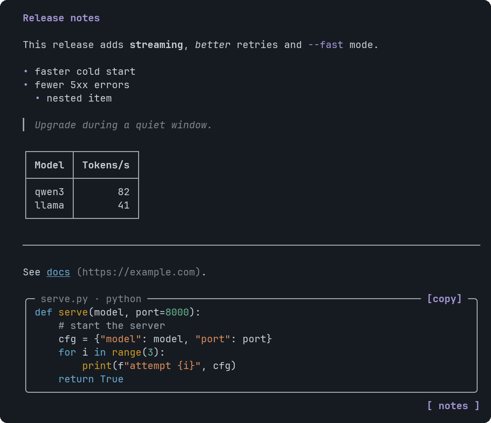
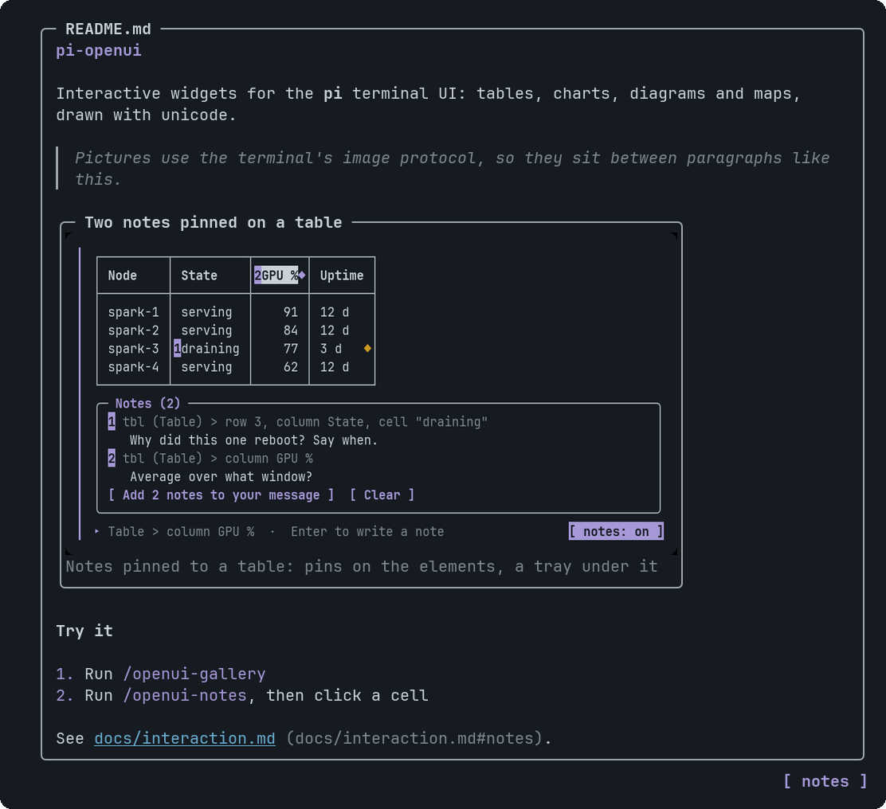

# Markdown

Formatted text from a markdown string.


<sub>Headings, emphasis, lists, a quote, a table, a rule and a link</sub>


<sub>A picture inside the text, written as a line of its own, with its caption underneath</sub>

## Signature

```text
Markdown(text: string)
```

## When to use

- Release notes, explanations, anything with structure.
- A README-style view: text with pictures in it.

## Arguments

### Markdown

| # | Argument | Type | Required | Notes |
|---|---|---|---|---|
| 1 | `text` | `string` | yes | Markdown. Use `\n` for newlines. Supported: `#`-`######` headings, **bold**, *italic*, `code`, ~~strike~~, `[text](https://example.com)`, lists (nested), `>` quotes, tables, fenced code, `---`, and a picture: a line that is only ``. Limit: 30,000 characters at most. |

## Example

```openui
root = Stack([m])
m = Markdown("# Notes\n\nThis adds **streaming** and `--fast` mode.\n\n- faster start\n- fewer errors\n\n")
```

The picture file must exist when the widget is drawn, as for Image: a missing file is reported to the assistant as an error.

## Tips and pitfalls

- A picture is a line of its own: ``, with an optional caption in quotes after the path. In the middle of a sentence, inside a code fence or inside a quote the syntax stays text. Put a path that has spaces or parentheses in angle brackets.
- It is drawn by the same code as [Image](Image.md): a local file or a `data:` URI, sized by pi-tui, the labelled frame where the terminal has no graphics, a missing file or a web URL reported as an error. FAQ answers are markdown too, so they can hold pictures.
- A picture in Markdown has no tooltip. Use an Image component when it needs one. A widget holds 12 pictures in all.
- Links are shown as `text (url)`; they are not clickable.
- Fenced code blocks are highlighted like CodeBlock but have no copy button.
- Headings beyond the third level look like the third.

## Related

[Text](Text.md) · [CodeBlock](CodeBlock.md) · [Faq](Faq.md) · [Image](Image.md)
