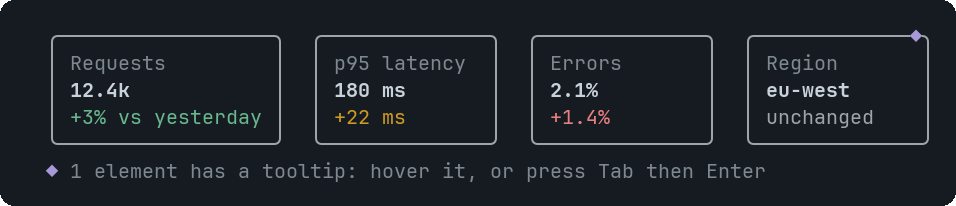

# Metric

A KPI tile: a label, a big value and an optional change line coloured by tone.


<sub>Four tones; the last tile carries a tooltip (the ◆ on its border)</sub>

## Signature

```text
Metric(label: string, value: string, delta?: string, tone?: "good" | "warn" | "bad" | "neutral", tooltips?: Tooltip[])
```

## When to use

- Headline numbers at the top of a dashboard.
- Status values with a trend.

## Arguments

### Metric

| # | Argument | Type | Required | Notes |
|---|---|---|---|---|
| 1 | `label` | `string` | yes | The small caption on top. This is also the tooltip target. |
| 2 | `value` | `string` | yes | The number or word, as a string: `"87%"`, `"4 / 4"`. |
| 3 | `delta` | `string` | no | The line under the value, for example `"+4% vs 1h ago"`. |
| 4 | `tone` | `"good" \| "warn" \| "bad" \| "neutral"` | no | Colours the delta: `good` green, `warn` amber, `bad` red, `neutral` grey. |
| 5 | `tooltips` | `Tooltip[]` | no | At most one, aimed at the label. Write `null` for `delta` and `tone` if you skip them. |

## Example

```openui
root = Stack([tiles])
tiles = Stack([a, b], "row")
a = Metric("Requests", "12.4k", "+3%", "good")
b = Metric("p95 latency", "180 ms", "+22 ms", "warn")
```

## Tooltips

Use the metric's own label. See [Tooltip](Tooltip.md). Write `null` for each skipped optional argument before `tooltips`, which is always last.

## Tips and pitfalls

- Values and deltas are strings, so format them yourself.
- Put tiles in a `"row"` Stack; in a column each one spans the full width.

## Related

[BarChart](BarChart.md) · [Table](Table.md) · [Tooltip](Tooltip.md)
