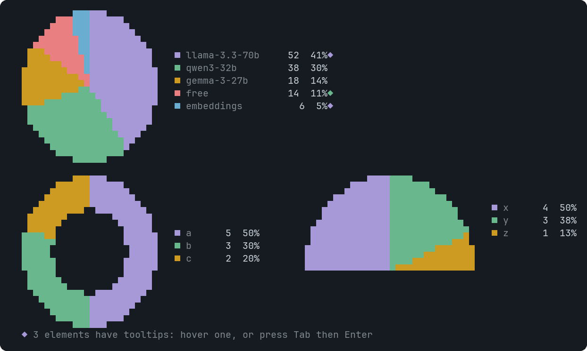
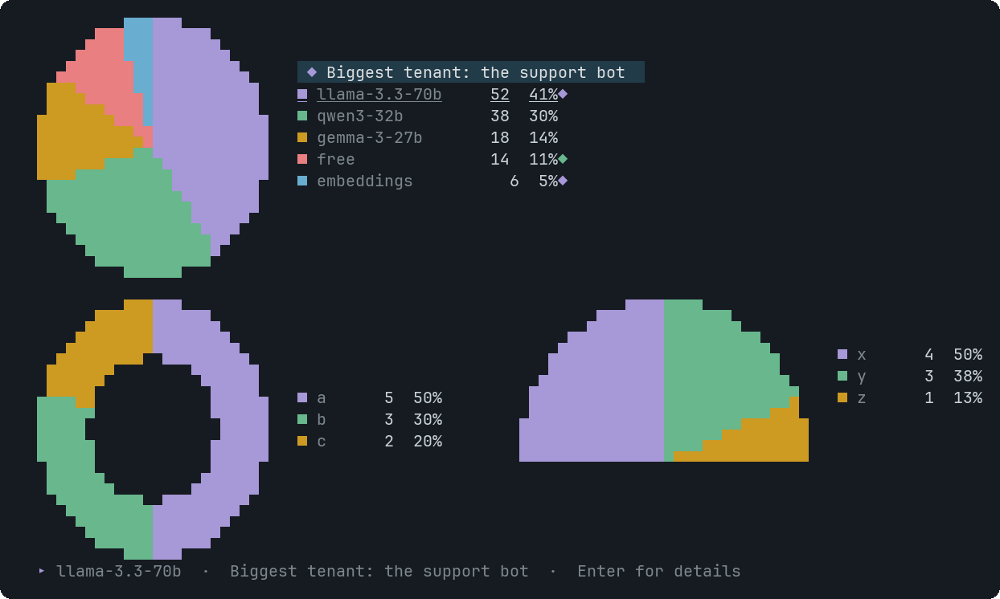

# PieChart

Parts of a whole as a coloured disc with a legend that shows each value and share.


<sub>A pie, a donut and a semicircle</sub>


<sub>Hovering a legend row (or its wedge) shows the tooltip</sub>

## Signature

```text
PieChart(labels: string[], values: number[], variant?: "pie" | "donut", appearance?: "circular" | "semiCircular", tooltips?: Tooltip[])
```

## When to use

- Shares of one total at one moment: memory per model, requests per type.

Not for: More than 8 slices, or close values that should be compared (use BarChart).

## Arguments

### PieChart

| # | Argument | Type | Required | Notes |
|---|---|---|---|---|
| 1 | `labels` | `string[]` | yes | One name per slice. |
| 2 | `values` | `number[]` | yes | Raw numbers, not percentages, same length as `labels`, none negative. |
| 3 | `variant` | `"pie" \| "donut"` | no | `pie` (filled, default) or `donut`. |
| 4 | `appearance` | `"circular" \| "semiCircular"` | no | `circular` (default) or `semiCircular` (the top half, drawn larger). |
| 5 | `tooltips` | `Tooltip[]` | no | Target: a slice label. Hover or click either the wedge or its legend row. |

## Example

```openui
root = Stack([c])
c = PieChart(["qwen3", "llama", "gemma", "free"], [38, 52, 18, 14], null, null, [t])
t = Tooltip("llama", "Biggest tenant", "Serves the support bot.")
```

## Tooltips

Use a slice label. See [Tooltip](Tooltip.md). Write `null` for each skipped optional argument before `tooltips`, which is always last.

## Tips and pitfalls

- Slices are sorted largest first and start at 12 o'clock (9 o'clock for a semicircle).
- The disc is drawn with half blocks in two colours per cell, so it needs a terminal with colour.

## Related

[BarChart](BarChart.md) · [AreaChart](AreaChart.md)
