# Components

Every component the assistant can draw. Each page shows what it looks like, its signature, every argument, an example that is checked by the test suite, and the interactions it supports.

A widget is written in OpenUI Lang: one `name = Component(...)` per line, positional arguments only, `root = Stack([...])` first. The assistant gets the full reference from `render_widget` with `reference=true`.

## Layout and text

<table>
<tr>
<td valign="top" width="33%"><a href="Stack.md">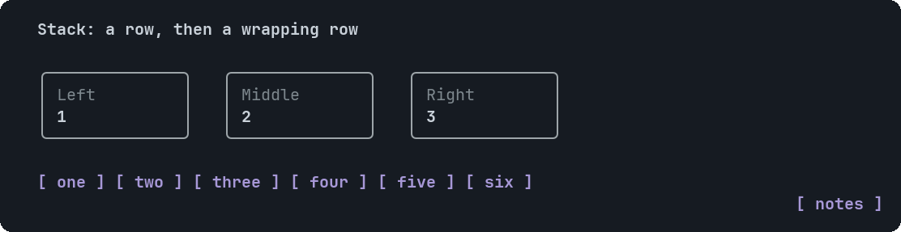</a> <b><a href="Stack.md">Stack</a></b> Lays its children out in a column (the default) or a row</td>
<td valign="top" width="33%"><a href="Text.md">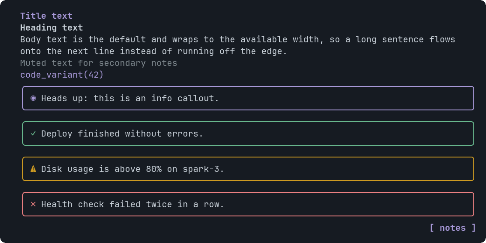</a> <b><a href="Text.md">Text</a></b> A line or paragraph of text</td>
<td valign="top" width="33%"><a href="Card.md">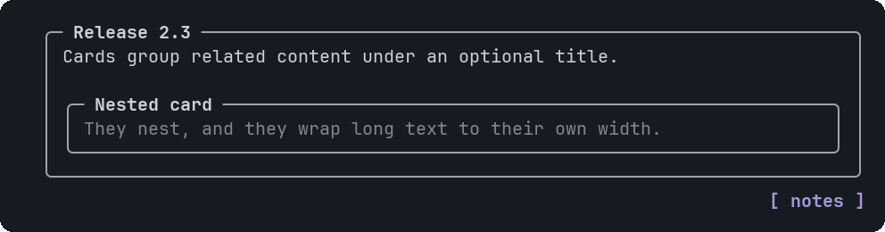</a> <b><a href="Card.md">Card</a></b> A bordered panel with an optional title in the top border</td>
</tr>
<tr>
<td valign="top" width="33%"><a href="Callout.md">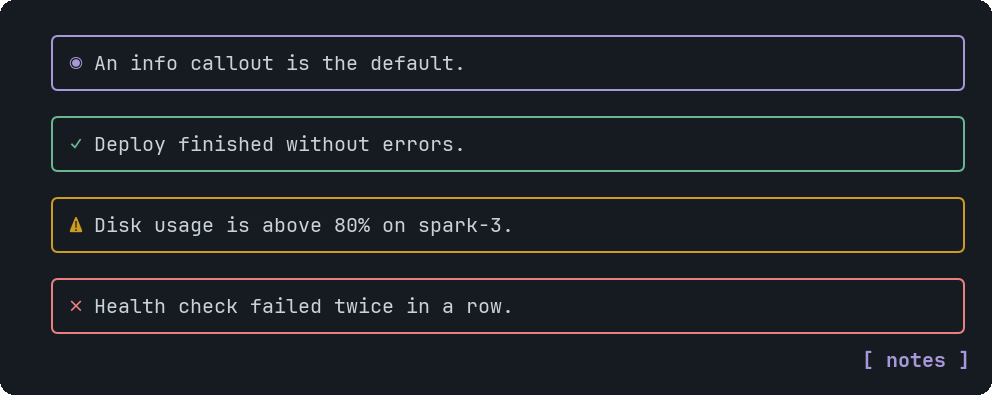</a> <b><a href="Callout.md">Callout</a></b> A highlighted note with an icon: information, success, a warning or an error</td>
<td></td>
<td></td>
</tr>
</table>

## Data

<table>
<tr>
<td valign="top" width="33%"><a href="Metric.md">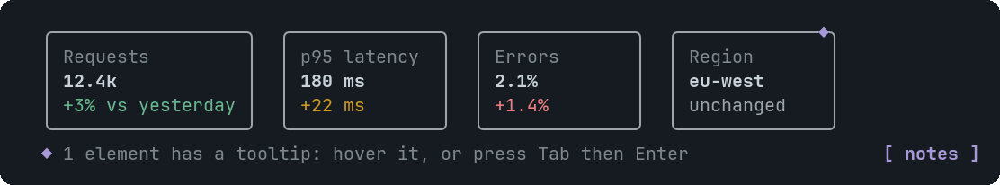</a> <b><a href="Metric.md">Metric</a></b> A KPI tile: a label, a big value and an optional change line coloured by tone</td>
<td valign="top" width="33%"><a href="Table.md">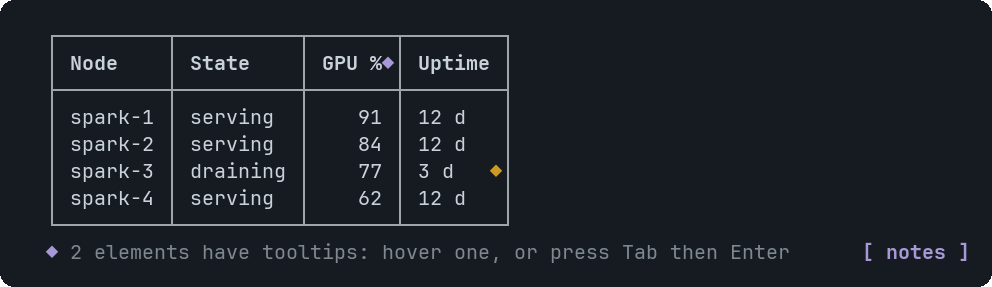</a> <b><a href="Table.md">Table</a></b> A table with a header row</td>
<td></td>
</tr>
</table>

## Interactive

<table>
<tr>
<td valign="top" width="33%"><a href="Tabs.md">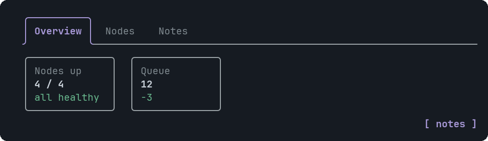</a> <b><a href="Tabs.md">Tabs</a></b> A strip of tab labels over the content of the selected tab</td>
<td valign="top" width="33%"><a href="Button.md">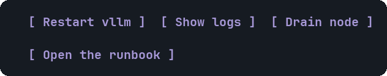</a> <b><a href="Button.md">Button</a></b> A clickable button that sends text to the assistant as your next message</td>
<td valign="top" width="33%"><a href="Choice.md">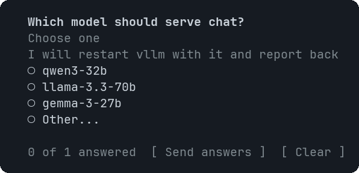</a> <b><a href="Choice.md">Choice</a></b> A question with clickable options for you to answer</td>
</tr>
<tr>
<td valign="top" width="33%"><a href="Faq.md">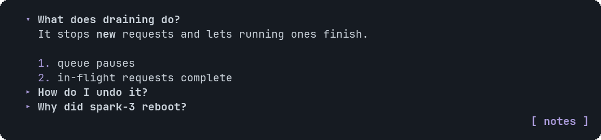</a> <b><a href="Faq.md">Faq</a></b> A list of questions that expand to show their answers</td>
<td></td>
<td></td>
</tr>
</table>

## Rich content

<table>
<tr>
<td valign="top" width="33%"><a href="Markdown.md">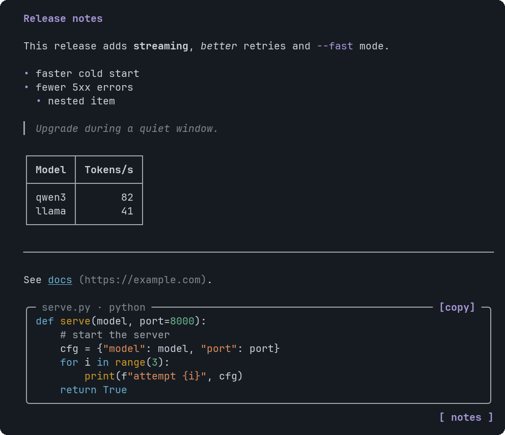</a> <b><a href="Markdown.md">Markdown</a></b> Formatted text from a markdown string</td>
<td valign="top" width="33%"><a href="CodeBlock.md">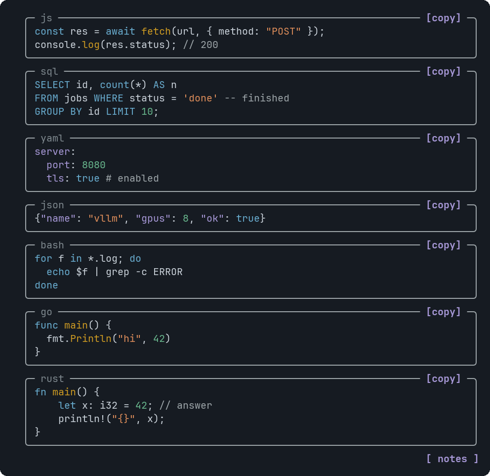</a> <b><a href="CodeBlock.md">CodeBlock</a></b> Syntax-highlighted code in a frame, with a copy button</td>
<td valign="top" width="33%"><a href="Image.md">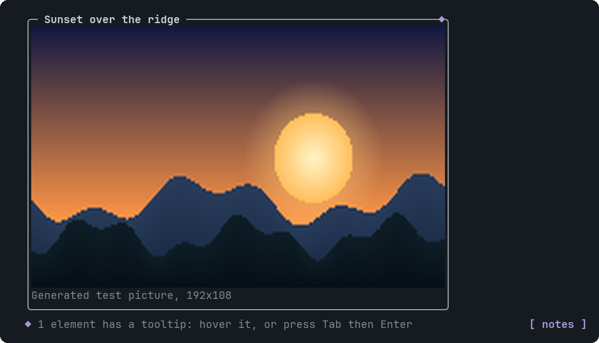</a> <b><a href="Image.md">Image</a></b> A picture, drawn for real in terminals that support images, framed, with an optional caption and tooltip</td>
</tr>
</table>

## Charts

<table>
<tr>
<td valign="top" width="33%"><a href="BarChart.md">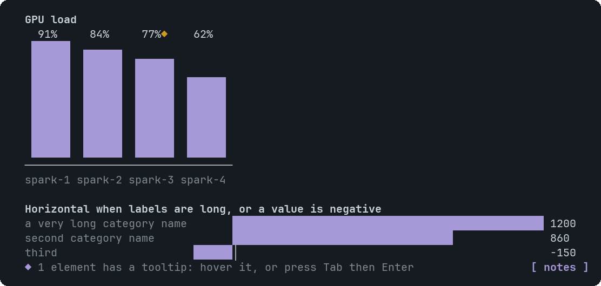</a> <b><a href="BarChart.md">BarChart</a></b> Bars for one series of categories</td>
<td valign="top" width="33%"><a href="LineChart.md">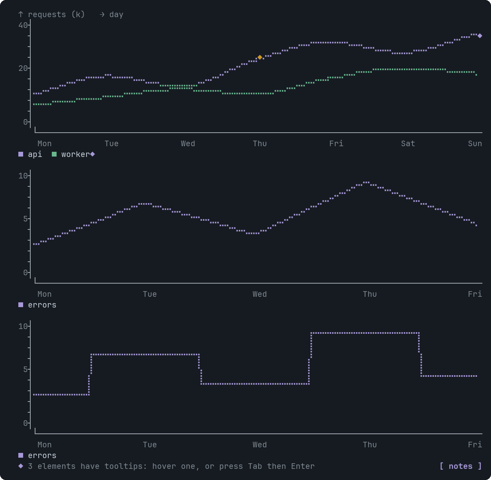</a> <b><a href="LineChart.md">LineChart</a></b> Lines over categories, one per series, drawn with braille dots</td>
<td valign="top" width="33%"><a href="AreaChart.md">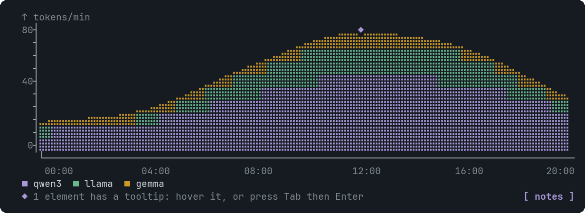</a> <b><a href="AreaChart.md">AreaChart</a></b> Like LineChart, but the series are stacked and filled, so it shows parts of a growing total</td>
</tr>
<tr>
<td valign="top" width="33%"><a href="PieChart.md">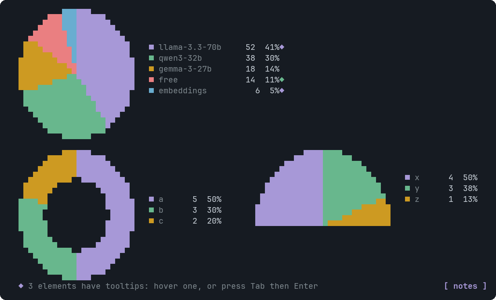</a> <b><a href="PieChart.md">PieChart</a></b> Parts of a whole as a coloured disc with a legend that shows each value and share</td>
<td valign="top" width="33%"><a href="RadarChart.md">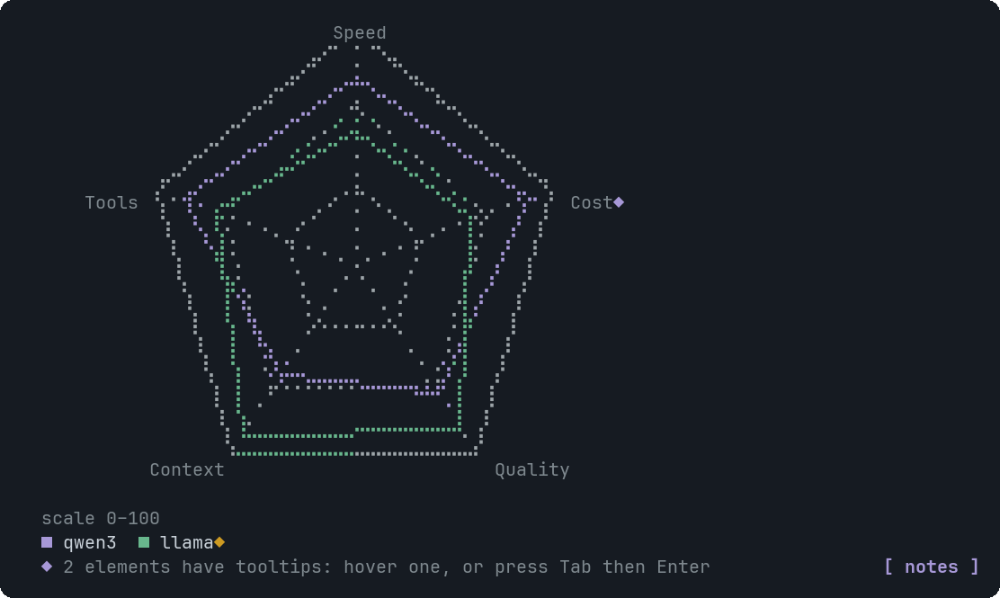</a> <b><a href="RadarChart.md">RadarChart</a></b> One axis per metric, one polygon per series: comparing entities across several measures</td>
<td></td>
</tr>
</table>

## Diagrams and maps

<table>
<tr>
<td valign="top" width="33%"><a href="GeoMap.md">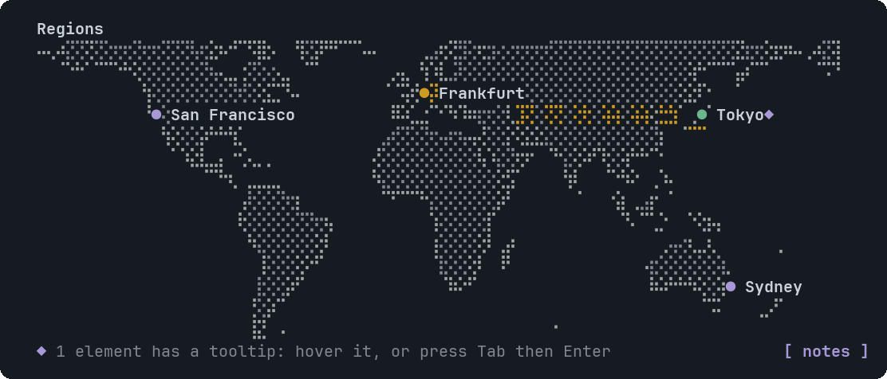</a> <b><a href="GeoMap.md">GeoMap</a></b> An offline world map zoomed to fit your pins, with optional dashed links</td>
<td valign="top" width="33%"><a href="Dag.md">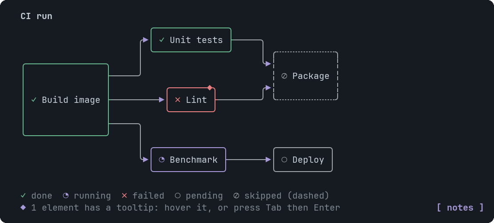</a> <b><a href="Dag.md">Dag</a></b> A directed graph with an automatic layered layout, for pipelines, task graphs and dependencies</td>
<td valign="top" width="33%"><a href="Erd.md">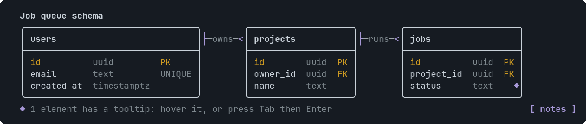</a> <b><a href="Erd.md">Erd</a></b> An entity-relationship diagram: tables with their columns, and relations with one-or-many ends</td>
</tr>
<tr>
<td valign="top" width="33%"><a href="InfraMap.md">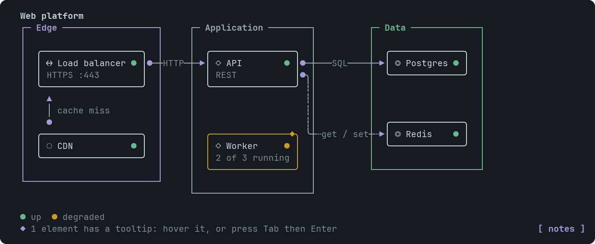</a> <b><a href="InfraMap.md">InfraMap</a></b> Zones holding nodes (servers, databases, queues), with labelled arrows showing which talks to which</td>
<td valign="top" width="33%"><a href="SequenceDiagram.md">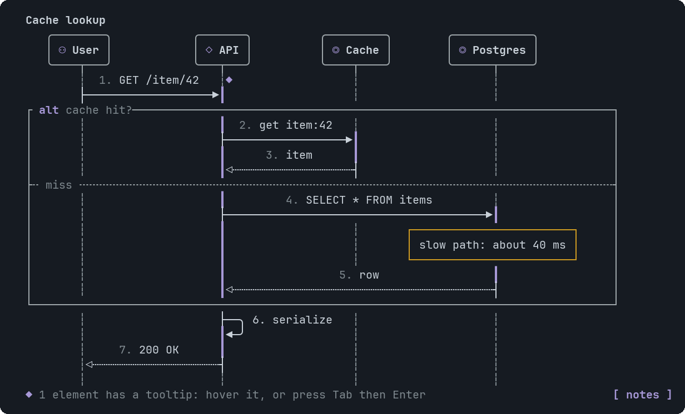</a> <b><a href="SequenceDiagram.md">SequenceDiagram</a></b> Calls between participants: columns left to right, steps top to bottom, with notes and alt/loop frames</td>
<td></td>
</tr>
</table>

## Used by every host

[Tooltip](Tooltip.md): A hint and an optional detail panel for one element of a host component.

## Size limits

A widget over a limit is not drawn, and the error names the limit and the line, so the assistant can shrink it. The limits keep every redraw cheap: pi draws all widgets on every frame, and a terminal shows about one screen anyway. Each component page repeats its own.

| What | Limit |
|---|---|
| The whole source | 100 KB |
| Components in one widget | 1500 |
| Nesting | 16 levels |
| Children of a Stack, Card or tab | 40 |
| Tabs | 12 |
| A string | 2000 characters (Text 8000, Markdown and CodeBlock 30000, a table cell 300) |
| Table | 100 rows by 16 columns |
| BarChart | 40 bars |
| LineChart, AreaChart | 200 points, 8 series |
| RadarChart | 16 axes, 8 series |
| Dag | 60 nodes, 150 edges |
| Erd | 20 entities, 30 fields each, 40 relations |
| InfraMap | 30 nodes, 45 links, 8 zones |
| SequenceDiagram | 100 steps, 10 participants |
| GeoMap | 100 points, 60 links |
| Faq | 30 items |
| Pictures | 12 (Image components and markdown picture lines together) |
| CodeBlock | 400 lines |
| Rows drawn | 1500 (the rest is cut and the widget says so) |
