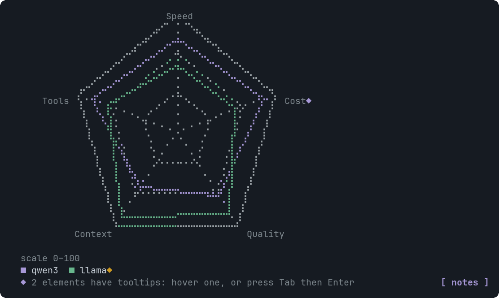

# RadarChart

One axis per metric, one polygon per series: comparing entities across several measures.


<sub>Two series over five axes</sub>

## Signature

```text
RadarChart(labels: string[], series: Series[], tooltips?: Tooltip[])
Series(category: string, values: number[])
```

## When to use

- Comparing a few options on the same scale: speed, cost, quality.

## Arguments

### RadarChart

| # | Argument | Type | Required | Notes |
|---|---|---|---|---|
| 1 | `labels` | `string[]` | yes | The axes: at least three. Limit: at most 16 items. |
| 2 | `series` | `Series[]` | yes | One Series per entity, each with one value per axis. Limit: at most 8 items. |
| 3 | `tooltips` | `Tooltip[]` | no | Targets: an axis label, or `series:<name>` (its legend entry). |

### Series

| # | Argument | Type | Required | Notes |
|---|---|---|---|---|
| 1 | `category` | `string` | yes | The entity name. |
| 2 | `values` | `number[]` | yes | Numbers parallel to the axes. Negative values count as 0. Limit: at most 200 items. |

## Example

```openui
root = Stack([r])
r = RadarChart(["Speed", "Cost", "Quality"], [a, b])
a = Series("qwen3", [80, 90, 70])
b = Series("llama", [55, 60, 88])
```

## Tooltips

Use an axis label or series:<name>. See [Tooltip](Tooltip.md). Write `null` for each skipped optional argument before `tooltips`, which is always last.

## Tips and pitfalls

- The scale runs from 0 to a round number above the largest value, printed under the chart.

## Related

[BarChart](BarChart.md) · [LineChart](LineChart.md)
