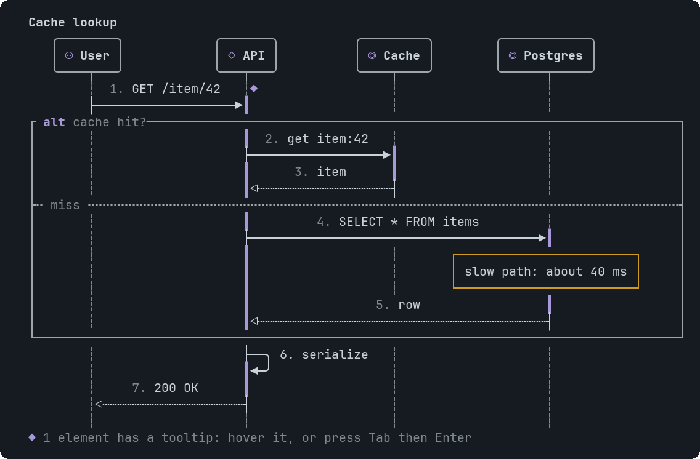

# SequenceDiagram

Calls between participants: columns left to right, steps top to bottom, with notes and alt/loop frames.


<sub>An alt/else frame, a note, a self-call and activation bars</sub>

## Signature

```text
SequenceDiagram(participants: SeqParticipant[], steps: (SeqMessage | SeqNote | SeqGroup)[], title?: string, numbered?: boolean, tooltips?: Tooltip[])
SeqParticipant(id: string, label: string, kind?: "actor" | "service" | "database" | "queue" | "external")
SeqMessage(from: string, to: string, label: string, style?: "sync" | "async" | "return", id?: string)
SeqNote(over: string, text: string, to?: string)
SeqGroup(kind: "alt" | "opt" | "loop" | "par", label: string, steps: (SeqMessage | SeqNote | SeqGroup)[], elseSteps?: (SeqMessage | SeqNote | SeqGroup)[], elseLabel?: string)
```

## When to use

- The order of calls in a request.
- Who calls whom, and what comes back.

Not for: More than about 5 participants or 20 steps: split it.

## Arguments

### SequenceDiagram

| # | Argument | Type | Required | Notes |
|---|---|---|---|---|
| 1 | `participants` | `SeqParticipant[]` | yes | One per column, at most 10. |
| 2 | `steps` | `(SeqMessage \| SeqNote \| SeqGroup)[]` | yes | Messages, notes and groups in order, at most 100. |
| 3 | `title` | `string` | no | A bold line above. |
| 4 | `numbered` | `boolean` | no | Number the messages (default yes). Pass `false` to turn it off. |
| 5 | `tooltips` | `Tooltip[]` | no | Targets: a participant id, or a SeqMessage `id` (a message without an id cannot carry a tooltip). |

### SeqParticipant

| # | Argument | Type | Required | Notes |
|---|---|---|---|---|
| 1 | `id` | `string` | yes | Unique. Messages and notes use it. Keep it short. |
| 2 | `label` | `string` | yes | The header text (22 characters at most). |
| 3 | `kind` | `"actor" \| "service" \| "database" \| "queue" \| "external"` | no | The header icon: `actor` ⚇, `service` ◇ (default), `database` ◎, `queue` ≡, `external` ◌. |

### SeqMessage

| # | Argument | Type | Required | Notes |
|---|---|---|---|---|
| 1 | `from` | `string` | yes | A participant id. `from` equal to `to` is a self-call (a small loop). |
| 2 | `to` | `string` | yes | A participant id. |
| 3 | `label` | `string` | yes | Shown above the arrow (48 characters). |
| 4 | `style` | `"sync" \| "async" \| "return"` | no | `sync` (solid, filled head, opens an activation bar on the receiver), `async` (solid, open head) or `return` (dashed, open head, closes the bar). |
| 5 | `id` | `string` | no | Only needed to attach a tooltip. Unique. |

### SeqNote

| # | Argument | Type | Required | Notes |
|---|---|---|---|---|
| 1 | `over` | `string` | yes | A participant id. |
| 2 | `text` | `string` | yes | Wrapped to the note's width. |
| 3 | `to` | `string` | no | A second participant: the note spans from `over` to `to`. |

### SeqGroup

| # | Argument | Type | Required | Notes |
|---|---|---|---|---|
| 1 | `kind` | `"alt" \| "opt" \| "loop" \| "par"` | yes | `alt` (if/else), `opt`, `loop` or `par`. |
| 2 | `label` | `string` | yes | Shown in the frame's tab. |
| 3 | `steps` | `(SeqMessage \| SeqNote \| SeqGroup)[]` | yes | The messages, notes and groups inside. |
| 4 | `elseSteps` | `(SeqMessage \| SeqNote \| SeqGroup)[]` | no | A second branch below a dashed divider. |
| 5 | `elseLabel` | `string` | no | Names the divider. |

## Example

```openui
root = Stack([d])
d = SequenceDiagram([u, api, db], [m1, m2, m3])
u = SeqParticipant("u", "User", "actor")
api = SeqParticipant("api", "API")
db = SeqParticipant("db", "Postgres", "database")
m1 = SeqMessage("u", "api", "GET /item/42")
m2 = SeqMessage("api", "db", "SELECT * FROM items")
m3 = SeqMessage("db", "api", "row", "return")
```

## Tooltips

Use a SeqParticipant id or a SeqMessage id (a message needs an id to carry a tooltip). See [Tooltip](Tooltip.md). Write `null` for each skipped optional argument before `tooltips`, which is always last.

## Tips and pitfalls

- Groups nest up to three deep.
- One SeqGroup per decision: put the other side in `elseSteps`, not in a second group.
- Participant headers are targets for tooltips.

## Related

[Dag](Dag.md) · [InfraMap](InfraMap.md)
