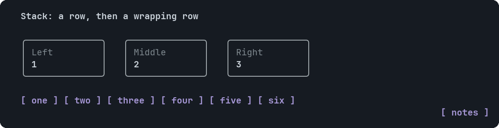

# Stack

Lays its children out in a column (the default) or a row. Every widget starts with `root = Stack([...])`.


<sub>A row of tiles, then a row of buttons that wraps when it runs out of width</sub>

## Signature

```text
Stack(children: component[], direction?: "row" | "column", gap?: "none" | "xs" | "s" | "m" | "l" | "xl", wrap?: boolean)
```

## When to use

- The root of every widget.
- A row of metric tiles or buttons.
- Grouping a few components with a chosen gap.

Not for: Do not put a Stack inside a Stack just to add space: use `gap`.

## Arguments

### Stack

| # | Argument | Type | Required | Notes |
|---|---|---|---|---|
| 1 | `children` | `component[]` | yes | The components inside, top to bottom or left to right. At least one is useful; an empty Stack draws nothing. Limit: at most 40 items. |
| 2 | `direction` | `"row" \| "column"` | no | `"column"` (default) stacks them; `"row"` puts them side by side. |
| 3 | `gap` | `"none" \| "xs" \| "s" \| "m" \| "l" \| "xl"` | no | Space between children. In a column the steps are none/xs/s = no blank line, m/l = one, xl = two. In a row they are 0, 1, 1, 2, 3 and 4 columns for none, xs, s, m, l, xl. Default `m`. |
| 4 | `wrap` | `boolean` | no | In a row, start a new line when the next child does not fit. |

## Example

```openui
root = Stack([title, row])
title = Text("Two ways to lay out", "heading")
row = Stack([a, b, c], "row", "l")
a = Metric("Left", "1")
b = Metric("Middle", "2")
c = Metric("Right", "3")
```

## Tips and pitfalls

- In a row, buttons, metric tiles and short text keep their natural width; every other child shares what is left equally.
- A row that is wider than the terminal shrinks its widest children first, never below 6 columns.
- Inside Tabs, wrap a tab's content in one Stack: items placed directly in a tab touch each other.

## Related

[Card](Card.md) · [Tabs](Tabs.md) · [Text](Text.md)
