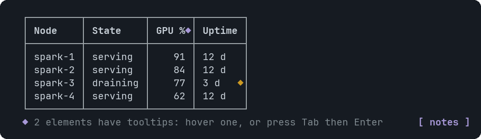
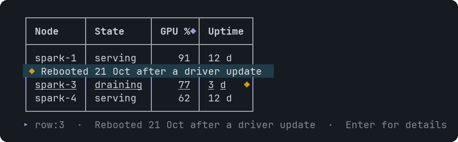
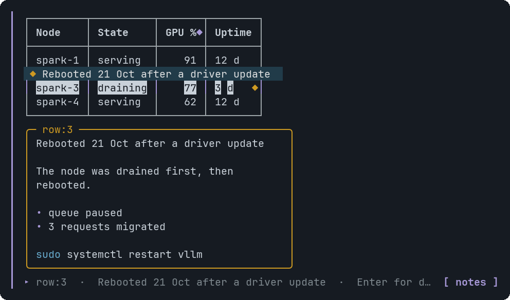
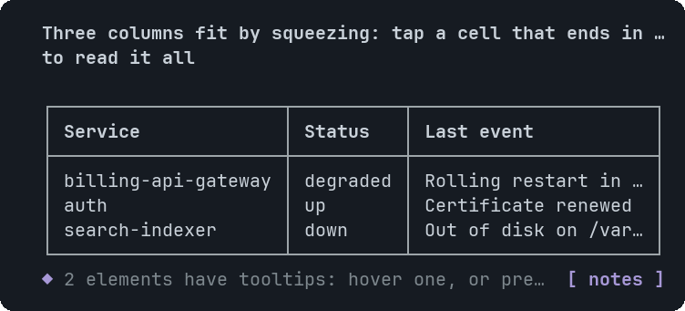
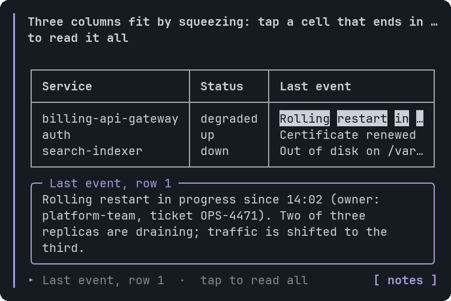
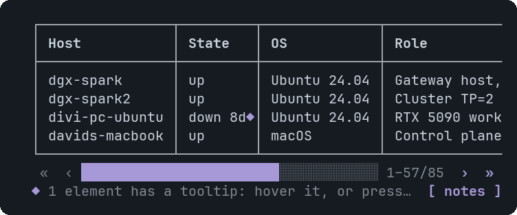

# Table

A table with a header row. Columns that hold only numbers are right-aligned.


<sub>Numbers right-aligned, long text truncated with an ellipsis</sub>


<sub>Hovering the row with a tooltip shows its hint in a bubble</sub>


<sub>Clicking it, or pressing Enter, opens the detail panel</sub>


<sub>On a narrow pane a few columns fit by squeezing: the cells that were cut end in an ellipsis</sub>


<sub>Tapping a cut cell (or Tab to it and Enter) opens it whole under the table, as plain text</sub>


<sub>Many columns do not fit: the table scrolls under a bar, and the columns the model pinned (Host and State here) stay in place</sub>

## Signature

```text
Table(columns: string[], rows: ((string | number)[])[], tooltips?: Tooltip[], pin?: string[])
```

## When to use

- Comparing a handful of items across several fields.
- A list of results with a status column.

Not for: More than about 12 rows: summarise, or split across Tabs.

## Arguments

### Table

| # | Argument | Type | Required | Notes |
|---|---|---|---|---|
| 1 | `columns` | `string[]` | yes | The header strings. Limit: at most 16 items. |
| 2 | `rows` | `((string \| number)[])[]` | yes | An array of rows. Each row has exactly one cell per column, a string or a number. A mismatch is a validation error that names the row. Limit: at most 100 rows, each at most 16 cells. |
| 3 | `tooltips` | `Tooltip[]` | no | Targets: `row:3` (1-based, not counting the header), `col:status`, or `cell:3.status`. Duplicate header names make `col:` and `cell:` ambiguous. |
| 4 | `pin` | `string[]` | no | The 4th argument: header names of the columns that stay in place while a table wider than the terminal scrolls sideways, such as `["Host"]` (write `null` for tooltips you do not have: `Table(cols, rows, null, ["Host"])`). Left out, nothing is pinned and the whole table scrolls. Pin only the one or two narrow columns that identify each row: pinned columns take at most half the width, and one that would not fit is not pinned (the table then scrolls whole). A name that is not a column is a validation error that lists the columns. On a table that fits, nothing changes. Limit: at most 16 items. |

## Example

```openui
root = Stack([t])
t = Table(["Node", "State", "GPU %"], [["spark-1", "serving", 91], ["spark-2", "draining", 84]], [tip])
tip = Tooltip("row:2", "Rebooting for a driver update")
```

## Interaction

- A tooltip target shows a `◆` in the cell padding after its text.
- Hover, or Tab to the row, for the bubble; click or Enter for the panel.
- A cell that was cut to fit ends in `…`. Click it, or Tab to it and press Enter, to open it whole under the table as plain text; click it again or press Esc to close it. A cut cell that also has a tooltip shows the whole text in the tooltip's panel.

## Tooltips

Use row:N (1-based), col:<header> or cell:N.<header>. See [Tooltip](Tooltip.md). Write `null` for each skipped optional argument before `tooltips`, which is always last.

## Tips and pitfalls

- When the table is wider than the terminal the widest columns shrink first, but never below the minimum column width (12 characters unless the user changes it: see Settings in the README).
- A table that still does not fit becomes a window that scrolls sideways under a pan bar. Nothing is pinned unless you list it in `pin`: pin the one or two narrow columns that identify each row (a host, an id, a date) when a row is hard to read without them, and leave `pin` out otherwise. Pinned columns never take more than half the width: they are tried in the order you list them, and one that would not fit is skipped (never squeezed), so a long column is not pinned by accident and nothing in the table is ever out of reach.
- While a wide table scrolls, its pinned columns are drawn first, in the order they have in the table, then the others. A table that fits is drawn in the order you wrote.
- You cannot see the width of the user's terminal, so do not shorten text to make a table fit: a column is squeezed only to the user's minimum width (and a cell cut by that squeeze ends in an ellipsis; the reader can tap it to read it whole); a table that needs more than that scrolls instead, and then no cell is cut.

## Related

[Markdown](Markdown.md) · [Metric](Metric.md) · [Tooltip](Tooltip.md)
