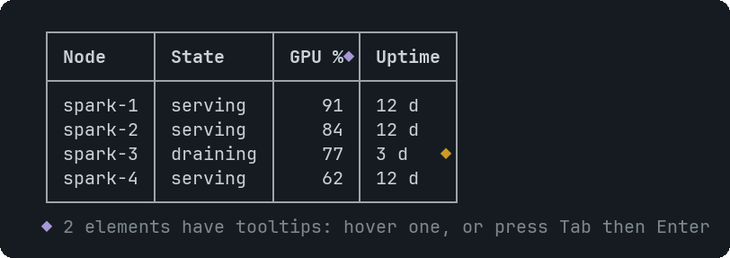
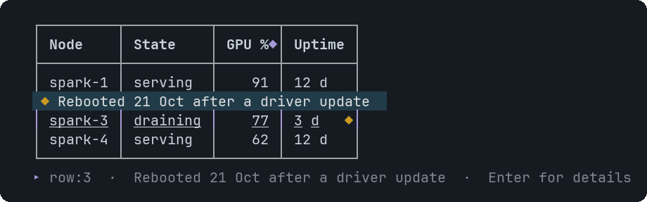
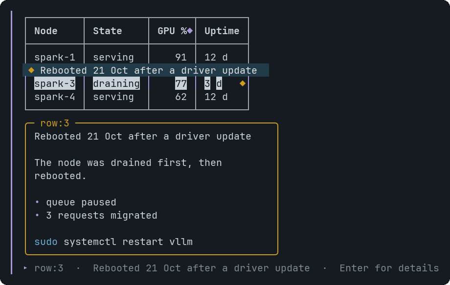

# Table

A table with a header row. Columns that hold only numbers are right-aligned.


<sub>Numbers right-aligned, long text truncated with an ellipsis</sub>


<sub>Hovering the row with a tooltip shows its hint in a bubble</sub>


<sub>Clicking it, or pressing Enter, opens the detail panel</sub>

## Signature

```text
Table(columns: string[], rows: ((string | number)[])[], tooltips?: Tooltip[])
```

## When to use

- Comparing a handful of items across several fields.
- A list of results with a status column.

Not for: More than about 12 rows: summarise, or split across Tabs.

## Arguments

### Table

| # | Argument | Type | Required | Notes |
|---|---|---|---|---|
| 1 | `columns` | `string[]` | yes | The header strings. |
| 2 | `rows` | `((string \| number)[])[]` | yes | An array of rows. Each row has exactly one cell per column, a string or a number. A mismatch is a validation error that names the row. |
| 3 | `tooltips` | `Tooltip[]` | no | Targets: `row:3` (1-based, not counting the header), `col:status`, or `cell:3.status`. Duplicate header names make `col:` and `cell:` ambiguous. |

## Example

```openui
root = Stack([t])
t = Table(["Node", "State", "GPU %"], [["spark-1", "serving", 91], ["spark-2", "draining", 84]], [tip])
tip = Tooltip("row:2", "Rebooting for a driver update")
```

## Interaction

- A tooltip target shows a `◆` in the cell padding after its text.
- Hover, or Tab to the row, for the bubble; click or Enter for the panel.

## Tooltips

Use row:N (1-based), col:<header> or cell:N.<header>. See [Tooltip](Tooltip.md). Write `null` for each skipped optional argument before `tooltips`, which is always last.

## Tips and pitfalls

- When the table is wider than the terminal the widest columns shrink first, to a minimum of 3 characters.
- A table that still does not fit becomes a scrollable window; moving focus to a target scrolls it into view.

## Related

[Markdown](Markdown.md) · [Metric](Metric.md) · [Tooltip](Tooltip.md)
