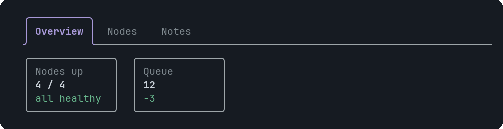
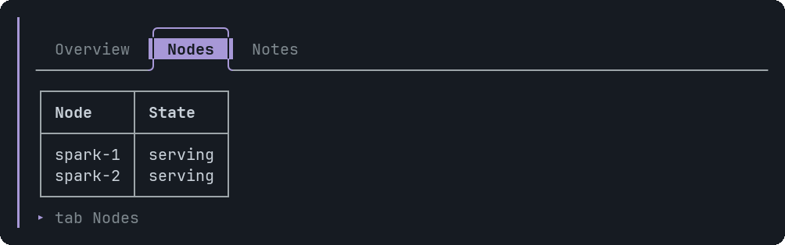

# Tabs

A strip of tab labels over the content of the selected tab.


<sub>The first tab is open when the widget is drawn</sub>


<sub>After clicking Nodes</sub>

## Signature

```text
Tabs(items: TabItem[])
TabItem(label: string, content: component[])
```

## When to use

- Alternate views of one subject: overview, nodes, notes.
- The same snippet in several languages.

Not for: Steps that must be read in order, or content the reader must see at once: a tab that is not selected is hidden.

## Arguments

### Tabs

| # | Argument | Type | Required | Notes |
|---|---|---|---|---|
| 1 | `items` | `TabItem[]` | yes | One TabItem per tab. The first is open at the start. |

### TabItem

| # | Argument | Type | Required | Notes |
|---|---|---|---|---|
| 1 | `label` | `string` | yes | The text in the strip. Cut to 22 characters, and shorter when the strip does not fit. |
| 2 | `content` | `component[]` | yes | The components in the tab. Wrap them in a single Stack: `[panel]`. |

## Example

```openui
root = Stack([tabs])
tabs = Tabs([a, b])
a = TabItem("Overview", [kpis])
kpis = Stack([m1, m2], "row")
m1 = Metric("Nodes up", "4 / 4", "healthy", "good")
m2 = Metric("Queue", "12", "-3", "good")
b = TabItem("Nodes", [tbl])
tbl = Table(["Node", "State"], [["spark-1", "serving"], ["spark-2", "serving"]])
```

## Interaction

- Click a tab, or Tab to it and press Enter. Clicking only switches the view; nothing is sent to the assistant.
- Tabs nest, and each remembers its own selection.

## Tips and pitfalls

- You cannot start on another tab: put the most useful one first.
- Every TabItem and everything in it must be reachable from `root`, like any other variable.

## Related

[Card](Card.md) · [Stack](Stack.md)
