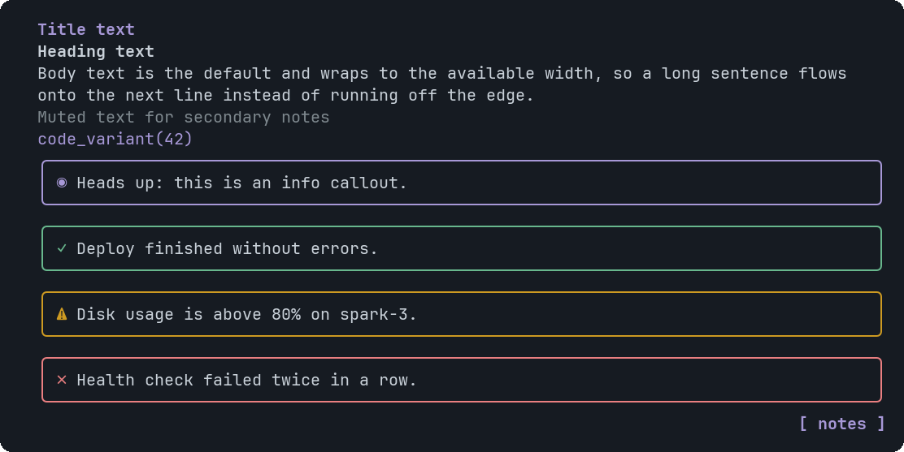

# Text

A line or paragraph of text. It wraps to the available width.


<sub>The five variants, and the four Callout tones that share this page's screenshot</sub>

## Signature

```text
Text(text: string, variant?: "title" | "heading" | "body" | "muted" | "code")
```

## When to use

- Titles and headings.
- Short explanations next to a chart.
- A muted note or a one-line code fragment.

Not for: For several paragraphs, lists or links use Markdown.

## Arguments

### Text

| # | Argument | Type | Required | Notes |
|---|---|---|---|---|
| 1 | `text` | `string` | yes | The words. `\n` starts a new line. No markup is interpreted. Limit: 8,000 characters at most. |
| 2 | `variant` | `"title" \| "heading" \| "body" \| "muted" \| "code"` | no | `title` (accent, bold), `heading` (bold), `body` (default), `muted` (dim) or `code`. |

## Example

```openui
root = Stack([t1, t2, t3])
t1 = Text("Cluster status", "title")
t2 = Text("Four nodes, all serving.")
t3 = Text("Updated 2 minutes ago", "muted")
```

## Tips and pitfalls

- A word longer than the line is broken rather than cut.
- There is no bold or italic inside Text; use Markdown for that.

## Related

[Markdown](Markdown.md) · [Callout](Callout.md)
