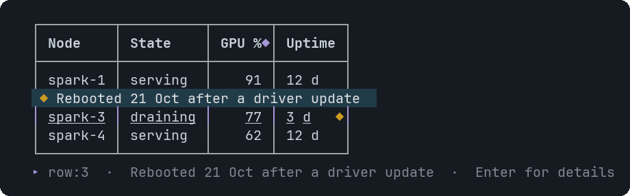
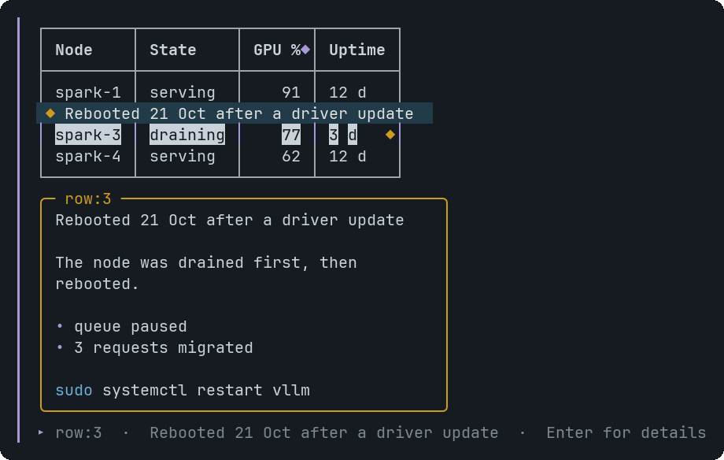
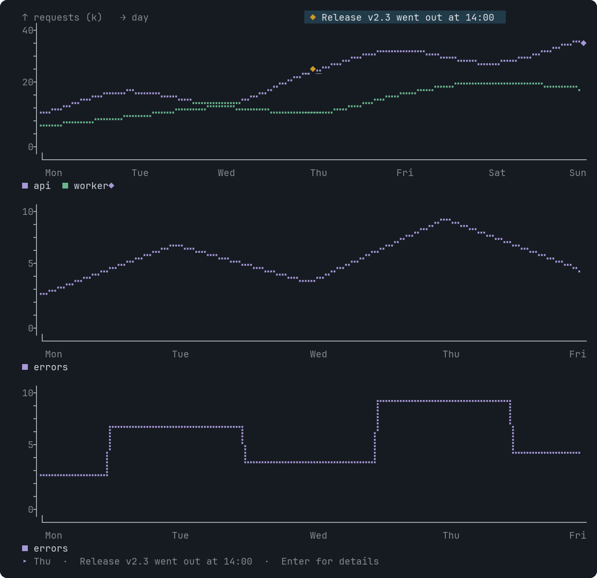
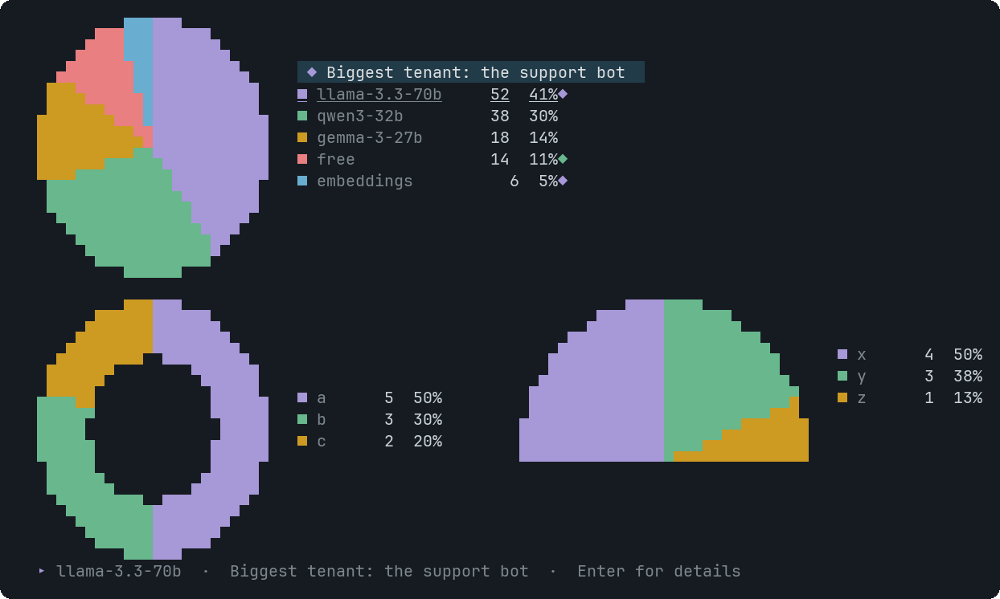

# Tooltip

A hint and an optional detail panel for one element of a host component. The element shows a `◆`; hover for the hint, click or press Enter for the panel.


<sub>Hover: a bubble with the hint appears next to the element</sub>


<sub>Click or Enter: the panel under the widget, with detail, code and a link</sub>


<sub>On a line chart the badge sits on the curve</sub>


<sub>On a pie the wedge and its legend row are both the target</sub>

## Signature

```text
Tooltip(target: string, hint?: string, detail?: string, code?: string, language?: string, tone?: "info" | "good" | "warn" | "bad", link?: string, linkLabel?: string)
```

A Tooltip draws nothing by itself. It goes in the `tooltips` argument of the component it describes, which is always that component's last argument.

## Arguments

| # | Argument | Type | Required | Notes |
|---|---|---|---|---|
| 1 | `target` | `string` | yes | Which element of the host. See the table below. |
| 2 | `hint` | `string` | no | Shown on hover in a bubble. 140 characters at most. |
| 3 | `detail` | `string` | no | The body of the panel that opens on click or Enter. 800 characters at most, markdown. |
| 4 | `code` | `string` | no | A command or snippet in the panel, highlighted for `language`. 40 lines at most. |
| 5 | `language` | `string` | no | `python`, `js`, `bash`, `sql`, `yaml`, `json`, `go` or `rust`. |
| 6 | `tone` | `"info" \| "good" \| "warn" \| "bad"` | no | `info` (default), `good`, `warn` or `bad`: the colour of the `◆` badge and the panel border. |
| 7 | `link` | `string` | no | An `http://` or `https://` link shown in the panel. A terminal cannot open it, so it is text to copy. |
| 8 | `linkLabel` | `string` | no | Text shown instead of the bare link. |

## Targets by host

| Host | `target` |
|---|---|
| [Metric](Metric.md) | Use the metric's own label. |
| [Table](Table.md) | Use row:N (1-based), col:<header> or cell:N.<header>. |
| [BarChart](BarChart.md) | Use a bar label. |
| [Image](Image.md) | Use the word image. |
| [Dag](Dag.md) | Use a DagNode id. |
| [Erd](Erd.md) | Use an Entity name or entity.column. |
| [GeoMap](GeoMap.md) | Use a GeoPoint label, or A>B for a link. |
| [LineChart](LineChart.md) | Use an x label (a category) or series:<name>. |
| [AreaChart](AreaChart.md) | Use an x label (a category) or series:<name>. |
| [PieChart](PieChart.md) | Use a slice label. |
| [RadarChart](RadarChart.md) | Use an axis label or series:<name>. |
| [InfraMap](InfraMap.md) | Use an InfraNode id, zone:<zone name>, or <fromId>><toId> for a link. |
| [SequenceDiagram](SequenceDiagram.md) | Use a SeqParticipant id or a SeqMessage id (a message needs an id to carry a tooltip). |

A target that matches nothing is a validation error that lists the valid targets, so the assistant can correct it. Two Tooltips on one target, a hint over 140 characters, and a link that is not `http(s)` are errors too.

## How it looks

- The element shows a `◆` in the tone colour: on the top border of a box, after the text of a one-line element, on the curve at an annotated point.
- Hover (or Tab to it) and a bubble with the hint appears next to it. The bubble is drawn over rows the widget already has, so nothing moves.
- Click or press Enter to open the panel under the widget. Esc closes it.
- Without a hint or detail there is nothing to show; one is enough.

## Example

```openui
root = Stack([c])
c = PieChart(["qwen3", "llama", "free"], [38, 52, 14], null, null, [t1, t2])
t1 = Tooltip("llama", "Biggest tenant", "Serves the support bot. Pinned to two nodes.", "vllm serve llama-3.3-70b --tensor-parallel-size 2", "bash", "info")
t2 = Tooltip("free", "Room for one more model", null, null, null, "good")
```

## Tips and pitfalls

- Add one only where there is something worth saying: about 8 per component at most (more than 12 is an error).
- Put the point in `hint`; use `detail` and `code` for the rest.
