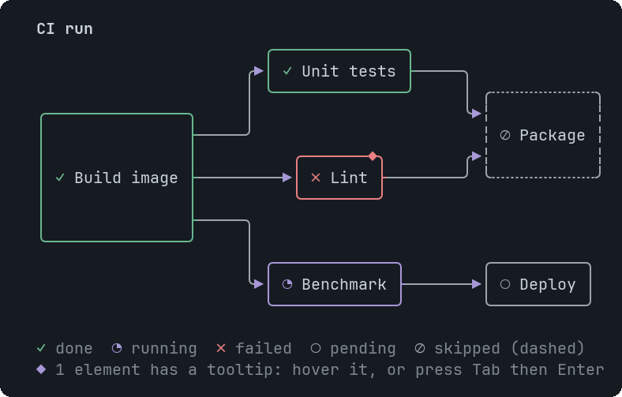
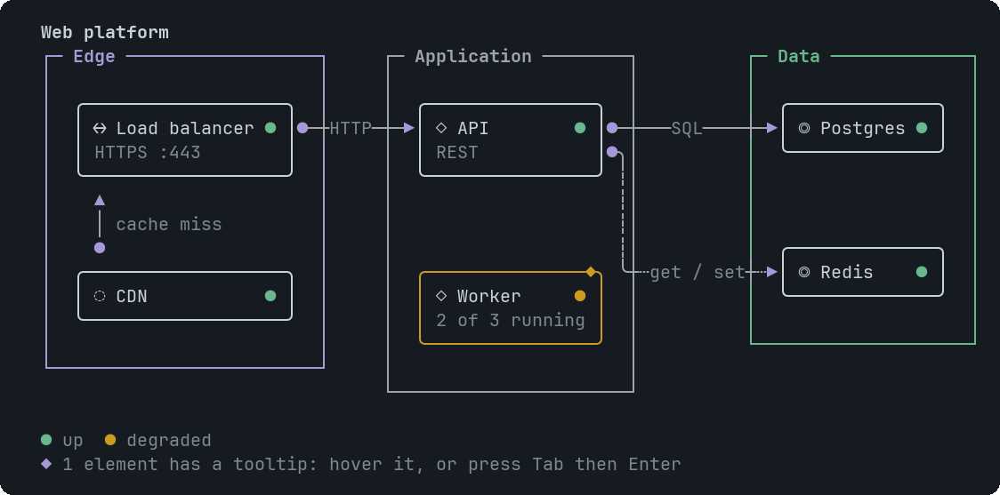

# The diagram engine

Dag, Erd and InfraMap share one engine in `src/diagram/`. The goal was a picture you can trust: every edge you asked for is
drawn exactly once, and no wire can be mistaken for another.

<table>
<tr>
<td valign="top"></td>
<td valign="top"></td>
</tr>
</table>

## Pipeline

1. **Normalise.** Bad input never throws. Duplicate ids, unknown ids, self loops and edges that are not pairs are dropped and
   reported as warnings under the picture.
2. **Place.** Dag and Erd use a layered layout (`layered.ts`): cycles are broken (the closing edge is drawn dashed), nodes get
   longest-path layers, edges that span layers get dummy points, crossings are reduced with barycenter sweeps and neighbour
   swaps, and cross-axis positions come from an exact per-layer fit (weighted isotonic regression). InfraMap places zones as
   columns or rows and stacks nodes inside them.
3. **Route.** `router.ts` runs one A* search per edge over the character grid. A wire may not share a cell with another wire.
   Two wires cross only at a right angle, going straight through (`┼`). Port cells next to a box belong to that box's own
   edges. Long edges follow lanes that are reserved before routing starts. If routing fails, the layout gets more room and is
   tried again.
4. **Draw.** `wires.ts` picks the glyph for every cell (rounded corners, dashed variants), the end marks, and the labels. A
   label goes inline on a long straight run, else beside it, else on a numbered footnote. A label is never lost.
5. **Fit.** The result is tried left to right and top to bottom, with progressively shorter labels, until it fits the width. If
   nothing fits, the shortest is returned, marked `overflow`, and the view scrolls.

## What the glyphs mean

| Glyph | Meaning |
|---|---|
| `─ │ ╭ ╮ ╰ ╯` | A wire and its corners. `┄ ┆` is a dashed wire. |
| `┼` | Two wires crossing at a right angle. They are not connected. |
| `▶ ▼ ◀ ▲` | An arrowhead (Dag, InfraMap). |
| `●` at a wire's start | The source end of an InfraMap link. |
| `├ ┤ ┬ ┴` | ERD "one": a bar across the wire, next to the table. |
| `< > Λ V` | ERD "many": a crow's foot facing the table. |
| `✓ ◔ ✗ ○ ⊘` | Dag status: done, running, failed, pending, skipped (the box is also dashed). |

## The failure contract

A drawn wire is always unambiguous. If an edge cannot be routed cleanly it is left out and listed under the picture:

```
lint -> package (not drawn)
```

The picture is never made to look complete by drawing something misleading.

## How it is tested

`src/diagram/decode.ts` is an oracle that shares no code with the router. It reads only the finished glyphs and the box
rectangles, walks every wire from its boxes, and rebuilds the edge list. Every test is a round trip:

```
decode(render(graph)) == graph
```

This is run on hand-picked cases (cycles, skip edges, fan-out, K3,3, wide characters in labels, empty labels) and on random
inputs: 250 DAGs, 150 schemas and 150 infrastructure maps with cycles, duplicates and CJK text, plus 100 to 150 node graphs
(0.4 to 0.6 seconds). The oracle also checks that the mark at the end of a relation faces the box it touches, so a flipped
crow's foot fails a test.

Bugs this found: wires sharing the port cells of a box (100-node graphs), link labels lost on 2-cell links, dashed links that
vanished on short runs.

## Limits

- Dense random graphs of 11 or more nodes are often wider than 100 columns. They scroll.
- Routing is a heuristic. A hand-drawn layout of a very tangled graph may do better.
