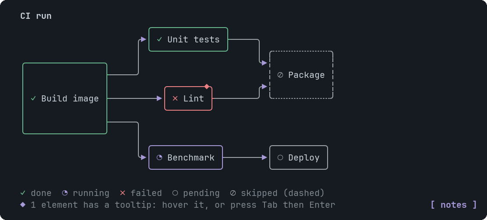
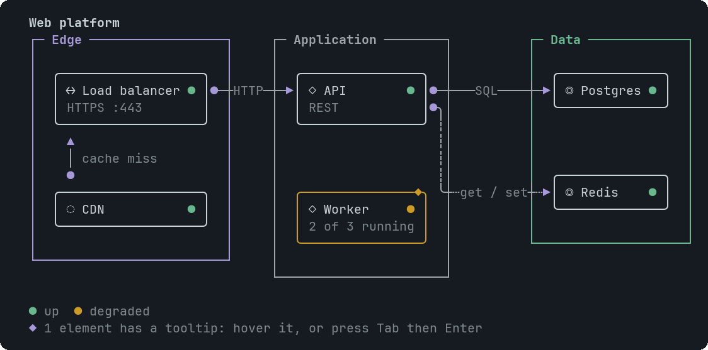

# The diagram engine

Dag, Graph, Erd and InfraMap share one engine in `src/diagram/`. The goal was a picture you can trust: every edge you asked for is
drawn exactly once, and no wire can be mistaken for another.

<table>
<tr>
<td valign="top"></td>
<td valign="top"></td>
</tr>
</table>

## Pipeline

1. **Normalise.** Bad input never throws. Duplicate ids, unknown ids, self loops and edges that are not pairs are dropped and
   reported as warnings under the picture.
2. **Place.** Dag and Erd use a layered layout (`layered.ts`): cycles are broken (the closing edge is drawn dashed), nodes get
   longest-path layers, edges that span layers get dummy points, crossings are reduced with barycenter sweeps and neighbour
   swaps, and cross-axis positions come from an exact per-layer fit (weighted isotonic regression). InfraMap places zones as
   columns or rows and stacks nodes inside them.
3. **Route.** `router.ts` runs one A* search per edge over the character grid. A wire may not share a cell with another wire.
   Two wires cross only at a right angle, going straight through (`┼`). Port cells next to a box belong to that box's own
   edges. Long edges follow lanes that are reserved before routing starts. If routing fails, the layout gets more room and is
   tried again.
4. **Draw.** `wires.ts` picks the glyph for every cell (rounded corners, dashed variants), the end marks, and the labels. A
   label goes inline on a long straight run, else beside it, else on a numbered footnote. A label is never lost.
5. **Fit.** The result is tried left to right and top to bottom, with progressively shorter labels down to a floor (14 characters
   for a Dag, 30 for an ERD's field lines, 12 for an InfraMap), until it fits the width. If nothing fits, the version with whole
   labels is returned, marked `overflow`, and the view scrolls under a pan bar (see
   [interaction.md](interaction.md#wide-diagrams-and-tables)). A label that was shortened to fit ends in `…`; `/openui-gallery wide`
   shows a Dag, an InfraMap, an ERD and a sequence diagram on a phone-width pane.

## Loops (Graph)

A Dag breaks a cycle by drawing the closing edge dashed and back. A Graph keeps its loops and labels every edge, so it takes a
second path through the same engine (`loops: true` in `layeredDiagram.ts`, geometry in `loops.ts`, nodes and options in `graph.ts`):

1. **Split.** Edges from a node to itself are *self-loops*. A depth-first search from the start nodes finds the edges that close a
   cycle: the *back edges*. The rest go forward. Only the forward edges are given to the layered layout, so a loop never pulls a
   node out of its layer.
2. **Lanes.** A back edge is an arc in a lane outside the body: below it when the graph runs left to right, to the right of it
   when it runs top to bottom. Arcs are given lanes shortest first, each into the lowest lane that no earlier arc overlaps, so a
   longer arc lies outside a shorter one it contains and arcs that do not overlap share a lane. The ports at one node are ordered
   so the deepest arcs are nearest its middle. Top to bottom a lane is as far from the last as its widest label is long, because
   a label stands beside a vertical line.
3. **Self-loops** sit on the side of the node that faces away from the lanes (above it, or to its left), several nested, and the
   layout leaves room for them and their labels.
4. **Commit before routing.** Self-loops, then arcs, are committed to the router before any forward edge, so everything else
   routes around them. An arc's straight way out is used when its cells are free; when another node of its layer is in the way it
   is searched for with the router, through the gaps between layers.
5. **Room for labels.** Left to right a forward edge's label is in the gap between layers, which is made wide enough. Top to bottom
   it stands beside its wire, so nodes are spaced by the labels of their edges, and when a label would still touch a lane the lanes
   move out. A label that finds no room beside its wire is a number on the wire and a footnote, as for every diagram.

A start node is a filled dot `●` and an end node a ring `◉`; the wire meets the dot itself, so top to bottom the caption is above
a start dot and below an end dot.

A Graph scrolls like the others: when it does not fit even top to bottom the whole picture, arcs and lanes included, scrolls under
the pan bar with whole labels. `test/pan-tooltip.test.ts` draws every sample at every pan offset.

## What the glyphs mean

| Glyph | Meaning |
|---|---|
| `─ │ ╭ ╮ ╰ ╯` | A wire and its corners. `┄ ┆` is a dashed wire. |
| `┼` | Two wires crossing at a right angle. They are not connected. |
| `▶ ▼ ◀ ▲` | An arrowhead (Dag, Graph, InfraMap). |
| `●` `◉` in a Graph | A start dot and an end ring, with their caption. |
| `●` at a wire's start | The source end of an InfraMap link. |
| `├ ┤ ┬ ┴` | ERD "one": a bar across the wire, next to the table. |
| `< > Λ V` | ERD "many": a crow's foot facing the table. |
| `✓ ◔ ✗ ○ ⊘` | Dag status: done, running, failed, pending, skipped (the box is also dashed). |

## The failure contract

A drawn wire is always unambiguous. If an edge cannot be routed cleanly it is left out and listed under the picture:

```
lint -> package (not drawn)
```

The picture is never made to look complete by drawing something misleading.

## How it is tested

`src/diagram/decode.ts` is an oracle that shares no code with the router. It reads only the finished glyphs and the box
rectangles, walks every wire from its boxes, and rebuilds the edge list. Every test is a round trip:

```
decode(render(graph)) == graph
```

This is run on hand-picked cases (cycles, skip edges, fan-out, K3,3, wide characters in labels, empty labels) and on random
inputs: 250 DAGs, 150 schemas and 150 infrastructure maps with cycles, duplicates and CJK text, plus 100 to 150 node graphs
(0.4 to 0.6 seconds). The oracle also checks that the mark at the end of a relation faces the box it touches, so a flipped
crow's foot fails a test.

Graph runs the same oracle on pictures without labels (a label written over a wire hides it from a decoder): 150 random graphs with
loops, back edges, self-loops and parallel edges decode back into exactly their edges. Graphs with labels, dots and statuses are checked
for what a decoder cannot see: each edge starts at its node, ends at its node in an arrowhead, is one connected line and meets no other
except at a right angle.

Bugs this found: wires sharing the port cells of a box (100-node graphs), link labels lost on 2-cell links, dashed links that
vanished on short runs.

## Limits

- Dense random graphs of 11 or more nodes are often wider than 100 columns. They scroll.
- Routing is a heuristic. A hand-drawn layout of a very tangled graph may do better.
