# Interaction

Widgets respond to the mouse and to the keyboard. Both do the same things, and neither gets in the way of typing in pi.

## The two modes of a widget

A widget is **idle** until you click it, or run `/openui-focus`. Then it is **armed**: a bar appears at its left edge and a
hint line above pi's editor lists the keys. While a widget is idle nothing you type is affected.

Pressing Esc leaves it. So does typing: any letter, digit, space or pasted text hands the keyboard straight back to pi's
editor, so Enter sends your message and does not fire the focused button.

## Mouse

Pi's fullscreen mode (the default) reports the mouse.

| You do | What happens |
|---|---|
| Hover an element | It is underlined (boxes and frames turn bold and accent-coloured). If it has a tooltip, a bubble with the hint appears next to it. The line under the widget says what the element does. |
| Click a tab, a question, a choice, a button | It acts. A button or choice also arms the widget. A choice only stages your answer (see [Choices](#choices)). |
| Click an element with a tooltip | Its panel opens under the widget. Click again to close it. |
| Click `[copy]` on a code block | The code goes to the clipboard. |
| Click empty space | Nothing: pi keeps it for text selection and scrolling. |

<table>
<tr>
<td valign="top">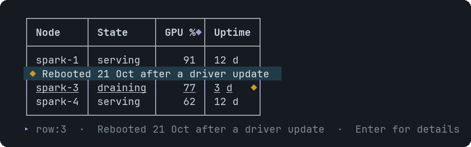</td>
<td valign="top">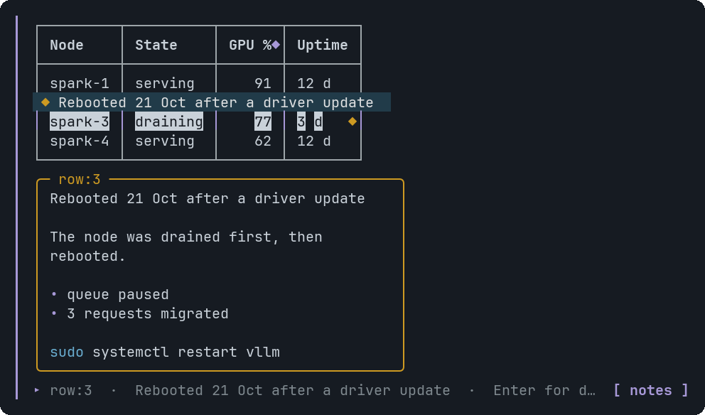</td>
</tr>
<tr><td><sub>Hover: the hint appears next to the row</sub></td><td><sub>Click or Enter: the panel</sub></td></tr>
</table>

## Keyboard

Once a widget is armed:

| Key | Does |
|---|---|
| Tab, Shift+Tab | Next or previous element in reading order. Wraps around. |
| Arrow keys | The neighbour in that direction. Left and Right prefer the same row and stop at its end; Up and Down prefer the same column. |
| Enter | Activates the focused element: switches a tab, opens or closes an FAQ question, stages a choice (Other opens the editor), presses a button or Send answers, copies code, opens or closes a tooltip panel. |
| Esc | Closes an open panel. Pressed again, leaves the widget. |

Anything you type that is not one of these goes to pi's editor and also disarms the widget.

<table>
<tr>
<td valign="top">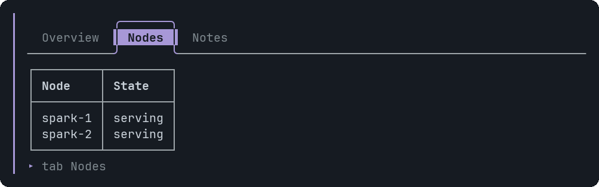</td>
<td valign="top">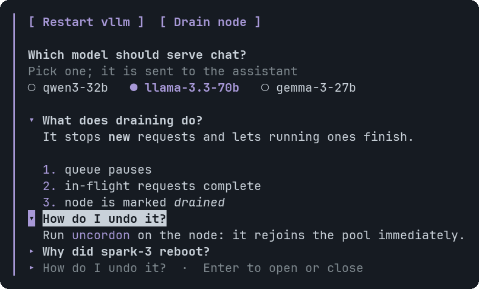</td>
</tr>
<tr><td><sub>Tabs switch in place</sub></td><td><sub>A staged choice is filled and the bar counts it; FAQ items open and close on their own</sub></td></tr>
</table>

## Tooltips

An element with a tooltip shows a `◆`, coloured by the tooltip's tone (info, good, warn, bad). The mark sits where you
look first:

- on the top border of a box (a node, a tile, a table of a schema, a picture's frame);
- right after the text of a one-line element (a table cell, a pie legend row, a radar axis);
- on the curve at the annotated point of a line or area chart.

When any element has a tooltip, the line under the widget says how many and how to reach them.

On a pie, hover either the wedge or its legend row. On a line or area chart, hover anywhere in the point's column.

See [Tooltip](components/Tooltip.md) for the targets each component accepts.

## Notes

A note is a comment you pin to one part of a widget: a table cell, a graph node, a pie slice, a paragraph. Use it to tell the
agent "this is wrong" or "explain this" without describing where the thing is. Notes never send anything by themselves.

<table>
<tr>
<td valign="top">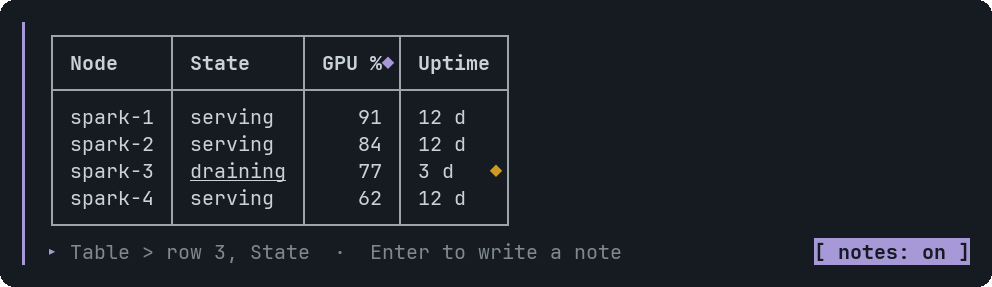</td>
<td valign="top">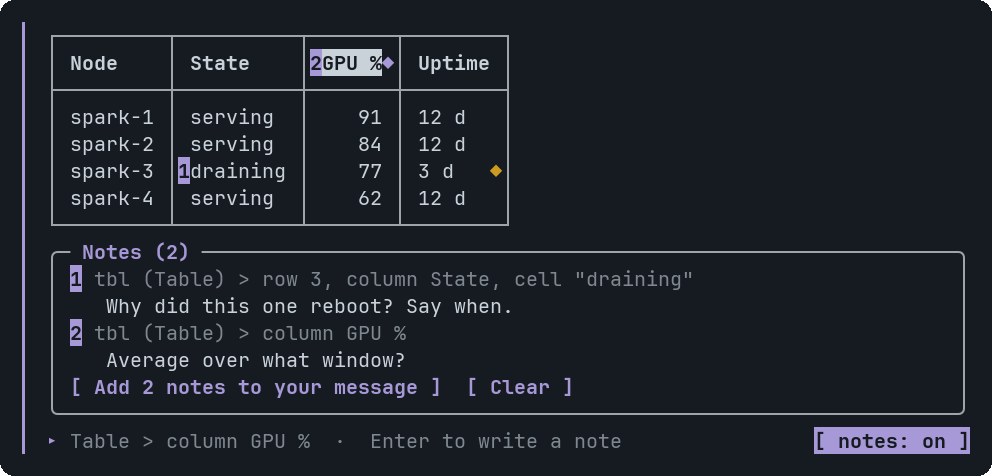</td>
</tr>
<tr><td><sub>Notes mode: hover shows what a click would pick</sub></td><td><sub>Two notes: numbered pins, and the tray under the widget</sub></td></tr>
</table>

1. Click `[ notes ]` at the bottom right of the widget, or run `/openui-notes`. The chip becomes `[ notes: on ]`. A widget with
   nothing to annotate, such as a row of buttons, has no chip.
2. Click the part you mean, or Tab to it and press Enter. In notes mode a click never presses a button, picks a choice or sends answers.
3. pi's own editor opens, titled with what you picked (`Note on Table > row 3, State`). Type, then press Enter to save.
   Shift+Enter adds a line. Esc cancels. Saving an empty note removes it.
4. The part gets a numbered pin and the note joins a tray under the widget.
5. Click `[ Add 2 notes to your message ]`, or reach it from the keyboard: Tab until it is focused (or press Down on a
   note in the tray, which lands on it), then Enter. The notes go into pi's message box as one numbered message, the widget
   leaves notes mode, and nothing is sent. Read it, edit it, add your own words, and press Enter when you are ready. That
   Enter is pi's: the widget has already given the keyboard back.

The message names each part the way the agent wrote it, so it can find the line in its own source: the variable name, the
component, the tab it sits on, and the part.

```text
Notes on the widget "Cluster status" (2). Please answer each note by its number. ...

1. `tbl` (Table) [tab "Nodes"] > row 3, column `State`, cell "draining"
   Why did this one reboot? Say when.
2. `tbl` (Table) [tab "Nodes"] > column `GPU %`
   Average over what window?
```

### What a click picks

| Component | Parts you can note |
|---|---|
| Text, Markdown, Callout, CodeBlock, Faq, Metric, Image | The whole component |
| Table | A row, a column or a cell |
| BarChart, PieChart | A bar or a slice |
| LineChart, AreaChart, RadarChart | A point (or axis) or a series |
| Dag, Erd, InfraMap, SequenceDiagram | A node, an entity or column, a zone, a link, a participant or a message |
| GeoMap | A pin or a link |

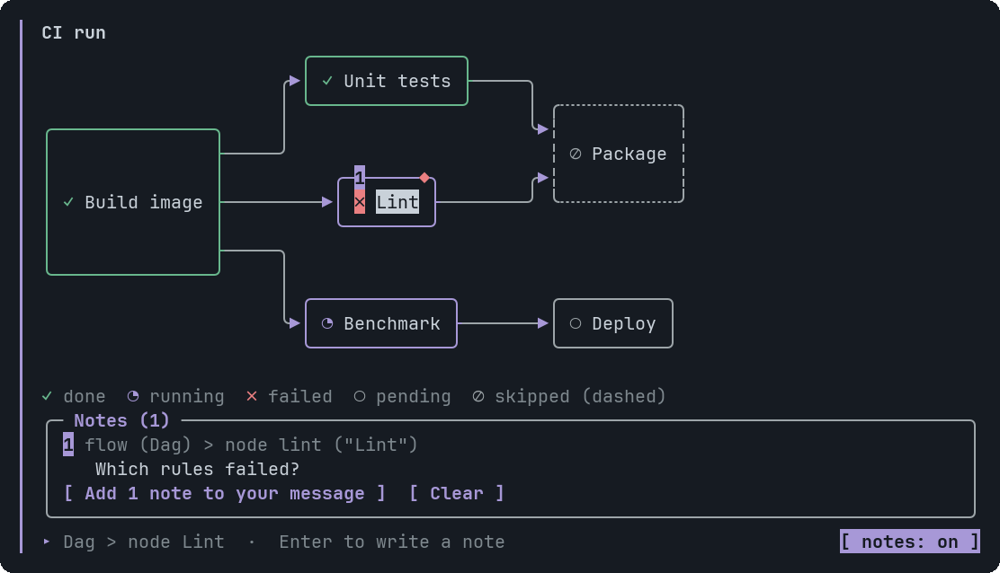
<sub>On a diagram the pin sits on the top border of the node, the same place a tooltip's `◆` goes</sub>

Every component with parts also lets you note the whole of it: Tab to it. Click picks the most specific thing under the
pointer (a cell). Shift+click, or Shift+Enter, picks what holds it (the row; a column's table). Stack, Card, Tabs, Button and
Choice have nothing to note.

### Keys in notes mode

| Key | Does |
|---|---|
| Tab, Shift+Tab | Next or previous component, then each note in the tray, then `[ Add ... ]`, `[ Clear ]` and the chip |
| Arrow keys | Among the parts of the component you are in; past the last part they move on to the next component |
| Enter | Write a note on the focused part, edit the focused note in the tray, or press the focused tray button (`[ Add ... ]` puts the notes in your message box, `[ Clear ]` discards them) |
| Down, on a note in the tray | Lands on `[ Add ... ]`, never on `[ Clear ]`, so Down then Enter is the short way to add. Left and Right move between the two buttons |
| Shift+Enter | Pick the part that holds the focused one |
| Delete, Backspace | Remove the focused note in the tray |
| Esc | Leave notes mode |

There is no single-key shortcut for Add: any letter belongs to pi's editor and ends notes mode. Notes mode ends when you start
typing a message, like any armed widget, so Enter sends your message and does not open an editor. While pi's editor is open the widget ignores the keyboard and mouse.

### Good to know

- A note on a tab that is not showing stays in the tray with its tab named, and its pin comes back with the tab.
- A widget holds 20 notes of up to 1,000 characters. At the limit you can still edit a note.
- Words that come from the widget (a label, a cell) are cleaned before they reach the message: control and invisible
  characters go, backticks and double quotes become single quotes, and `@name` becomes `(at)name`. A widget cannot slip a file
  reference into a message you are about to send.
- Notes live in memory with the widget. They are gone when the session ends or pi restarts.

## Choices

A Choice asks you a question. **A click does not send anything.** It stages your answer, and one bar under the widget sends
every answer of the widget together.

<table>
<tr>
<td valign="top">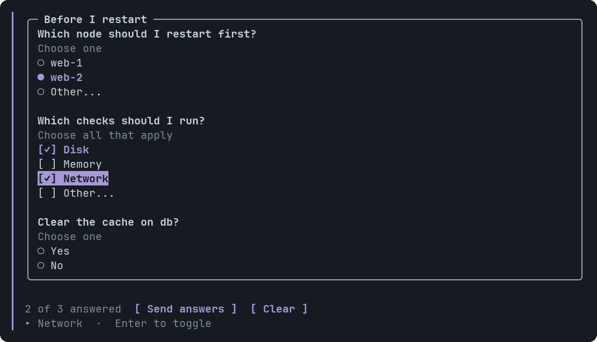</td>
<td valign="top">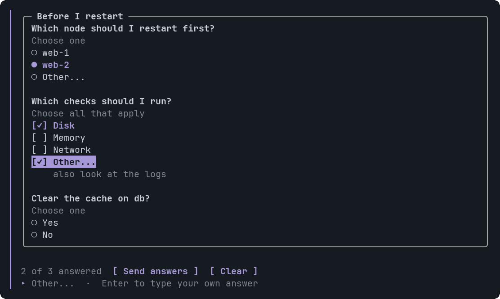</td>
</tr>
<tr><td><sub>Stage answers: the bar counts them</sub></td><td><sub>Other... opens pi's editor; the text shows under the row</sub></td></tr>
<tr>
<td valign="top">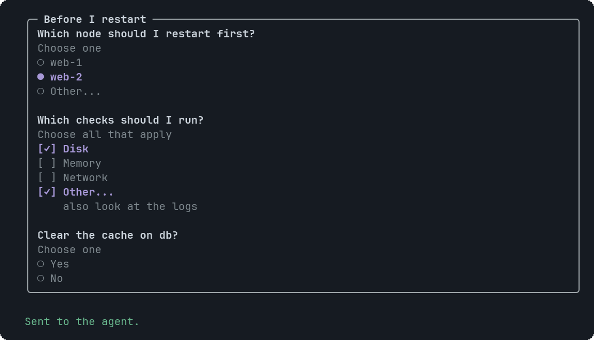</td>
<td></td>
</tr>
<tr><td><sub>Send answers locks the widget</sub></td><td></td></tr>
</table>

- A question that takes one answer shows round indicators and the tag `Choose one`. Clicking the chosen option again clears it;
  another option moves the pick. A question that takes several shows square checkboxes and `Choose all that apply`, and each
  option toggles on its own.
- **Other...** opens pi's own editor with the question as its title. Enter saves, Shift+Enter adds a line, Esc leaves your
  answer as it was. Saving text selects the row and shows the text under it (a single question drops its chosen option, a
  multiple one keeps them); saving nothing unselects it. The widget has no text box of its own, so the keyboard is never held
  by it: typing anywhere else still hands it back to pi.
- The bar reads `N of M answered`. It counts every question, also on a tab you have not opened. **[ Send answers ]** works once one
  is answered. **[ Clear ]** drops all staged answers. With the keyboard, Down from the last option reaches Send answers.
- Sending locks the widget: the chosen rows stay marked, the bar says `Sending to the agent…` and then `Sent to the agent.` once pi has taken the
  message, and nothing can be sent again. If pi cannot take it (no model, no credentials) the widget is given back with your answers. The
  widget gives the keyboard back to pi, so Enter sends your own message and presses nothing. The agent draws a new widget to
  ask again.
- In notes mode none of this answers: a click is for notes.
- Answers are kept in memory with the widget. They are gone when the session ends or pi restarts, and a widget redrawn from a
  resumed session opens unanswered, with Send answers live again.

What the agent receives is one message. One question that takes one answer, answered with an option, is the line
`<question> — <option>`. Anything else is a numbered list, with `(no answer)` for a question you skipped and `other:` before
your own words. The words the agent wrote are cleaned first (control characters out, `@file:` and similar defused, a question
that starts like a command never first in the message). Your own text is sent as you typed it. See
[Choice](components/Choice.md) for an example.

## Buttons and the agent

- In a widget the **agent drew**, a Button click sends text as a real user turn. The agent reads it as your next message, acts,
  and may draw a new widget. Send answers does the same with the answers to its Choices.
- In `/openui-gallery` and `/openui-file` widgets the click is only echoed in the transcript, so you can try everything
  at no cost.
- A Button with `@OpenUrl` copies the link to the clipboard and says so, because a terminal cannot open a browser from here.

## Wide diagrams and tables

Labels shrink and the direction switches before anything scrolls. When a diagram, table or sequence diagram is still wider than
the pane (a phone, a narrow split), it shows a window and a **pan bar** under it:

```text
 «  ‹ ███████████████░░░░░░░░░░░░░░░ 1–53/87  ›  »
```

`‹ ›` are the fine arrows, `« »` the page arrows.

<table>
<tr>
<td valign="top">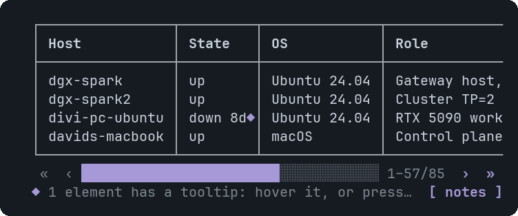</td>
<td valign="top">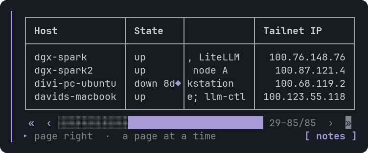</td>
</tr>
</table>

The bar appears only when something is cut off. The block under it is 87 cells wide and you see cells 1 to 53; the bar's filled
part is the window. Ways to move:

| Do | Result |
|---|---|
| Tap or click `‹` or `›` | A fine step: 8 cells, or what `scroll.step` says (see [Settings](../README.md#settings)). Read along a few characters at a time. |
| Tap or click `«` or `»` | A page: about three quarters of the window. A table lands on a column edge. |
| Click or drag on the bar | Place the window there, to the cell. |
| Sideways swipe, or a horizontal wheel | Scroll three columns. Where the terminal app sends it. |
| Shift+wheel (or Alt+wheel) over the block | Scroll three columns. A plain wheel still scrolls the transcript. |
| Tab to the bar, then Left and Right | A fine step. Shift+Left, Shift+Right, PageUp or PageDown: a page. This also works in notes mode, to reach a column you want to write a note about. |
| Move focus to a node | Scrolls it into view. |

### Pinned columns

In a table, **pinned columns stay in place** while the rest scrolls, so you can still tell which row you are reading. The agent
chooses them with `Table`'s `pin` argument, `Table(columns, rows, tooltips, ["Host", "State"])`. **Without it nothing is pinned**
and the whole table scrolls. They are limited to **half the width of the pane**: a pin that would take more is skipped (it is
never squeezed, because text cut by a squeeze could not be scrolled to), so there is always something to scroll and nothing out
of reach. While the table scrolls, pinned
columns are drawn first, in the order they have in the table; a table that fits is drawn in the order it was written. A cell wider
than the part that scrolls is read in pieces as it goes by (nothing is cut), so pin narrow columns.

A table shrinks its columns only down to a minimum width (12 characters; see [Settings](../README.md#settings)) before it scrolls.

A sideways swipe on a phone works only if the terminal app turns it into a horizontal wheel event. If yours does not, tap the
arrows or the bar.

### Reading a cell that was cut

A table with only a few columns is not scrolled: its columns are squeezed to fit (never below your minimum width), and a cell
that did not fit ends in `…`. Such a cell is a target. Click it, or Tab to it and press Enter, and it opens whole under the table,
as plain text with its line breaks (not Markdown). Click it again or press Esc to close it. Only one is open at a time. A cut
header can be opened the same way. It works in a Markdown table too.

<table>
<tr>
<td valign="top">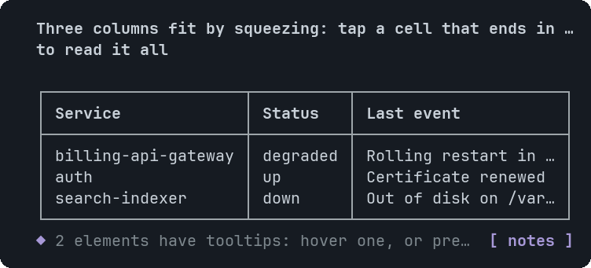</td>
<td valign="top">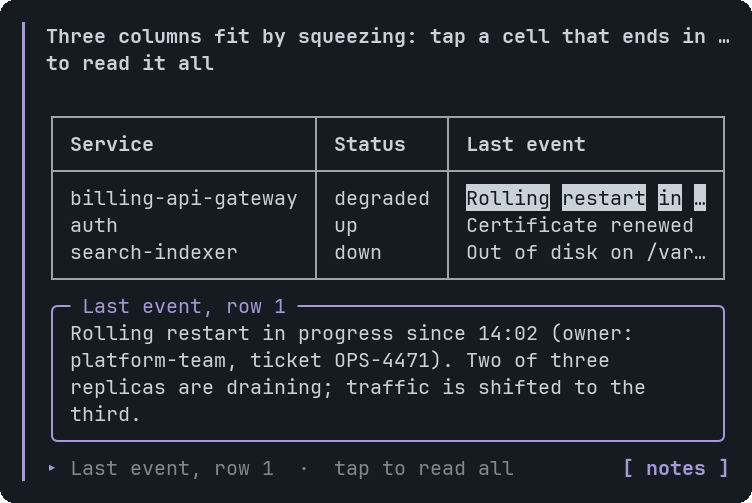</td>
</tr>
<tr><td><sub>Cut to fit: the ellipsis marks a cell you can open</sub></td><td><sub>Tapped: the whole cell, wrapped</sub></td></tr>
</table>

If the agent put a tooltip on that cell, the tooltip's panel opens instead and the whole text is added to it. A table that
scrolls cuts nothing, so it has none of these. To make more tables scroll rather than squeeze, raise `table.minColumnWidth` (see
[Settings](../README.md#settings)).

### Try it in a narrow pane

`/openui-gallery wide` draws eleven examples of things that do not fit a phone: a wide table with a pinned column, long cells,
code with a long line, tabs that wrap, tiles and buttons that wrap, a wide InfraMap, a Dag, an ERD, a sequence diagram, Markdown
with a wide code fence and table, and a card with a long title. Open pi in a pane about 60 columns wide (or on your phone) and run
it. [docs/gallery-narrow.txt](gallery-narrow.txt) is the same set drawn as text at 60 columns, so a change in how they look shows
in a diff.

### What scrolls, what wraps, what is cut

The rule is **pan rather than cut**: a component never draws wider than the pane, and text is not shortened with `…` when it can
be reached some other way.

| Component | On a narrow pane |
|---|---|
| [Table](components/Table.md) | Columns squeeze to your minimum width (`/openui-config`; a cell cut by that ends in `…` and opens whole when tapped), then it scrolls with every cell whole; the columns the agent pinned stay fixed. |
| [Dag](components/Dag.md), [Erd](components/Erd.md), [InfraMap](components/InfraMap.md), [SequenceDiagram](components/SequenceDiagram.md) | Labels shrink a little, the direction may switch, then it scrolls with **whole** labels. |
| [CodeBlock](components/CodeBlock.md), and code fences and tables in [Markdown](components/Markdown.md) | Lines are not cut: the code scrolls inside its box. |
| [Stack](components/Stack.md) rows of buttons and tiles | Wrap onto more rows. |
| [Tabs](components/Tabs.md) | The strip wraps onto more rows. |
| A title in a box's border | Moves inside the box as a wrapped heading if it does not fit. |
| Text, Callout, Faq, Choice | Wrap. A word longer than the line is broken. |
| [Image](components/Image.md) | Scaled to fit. The empty frame says what it is when the terminal does not draw the picture. |
| Charts, GeoMap | Resize to fit. Legend and label names are cut at a fixed length (24 characters for legends and slices, 14 around a radar), at any width. |

Any component that still comes out wider than the pane gets the pan bar, so nothing is cut by the widget without a way to see it.

Braille charts (lines, areas, the map) need the terminal font to draw the braille block (U+2800 to U+28FF) at the same width as a
letter. If your app falls back to another font for it, the dots come out slightly wider than the grid and a chart can run past the
edge of the screen; there is nothing the widget can do about that, and a font with braille (JetBrains Mono, for one) fixes it.

## Finding out what your terminal sends

Whether a swipe, a tap or a flick does anything depends on what your terminal app turns it into. `/openui-events on` records
what reaches a widget for five minutes (mouse events, and keys only when they are escape sequences or control keys: what you type
is never recorded), `/openui-events show` prints the last ones with what the widget made of them, and `off` and `clear` do what
they say. Do the gesture **over a widget**: a mouse event only reaches the widget under it. The file is
`~/.pi/agent/openui-events.log`.

```text
22:31:21.506 press btn=none x=9 y=1
22:31:21.506 -> pan to 3
```

## Copying

`[copy]` writes to the clipboard with an OSC 52 escape, which most modern terminals accept. If yours does not, select the
code with the mouse as you would anywhere else in pi.

## Pictures

An Image is placed by the terminal, so it cannot be underlined. Hovering or focusing it lights up its frame instead. See
[Image](components/Image.md) for formats and fallbacks.

A picture written inside a [Markdown](components/Markdown.md) (a line that is only ``) behaves the same way, except
that it cannot carry a tooltip.
